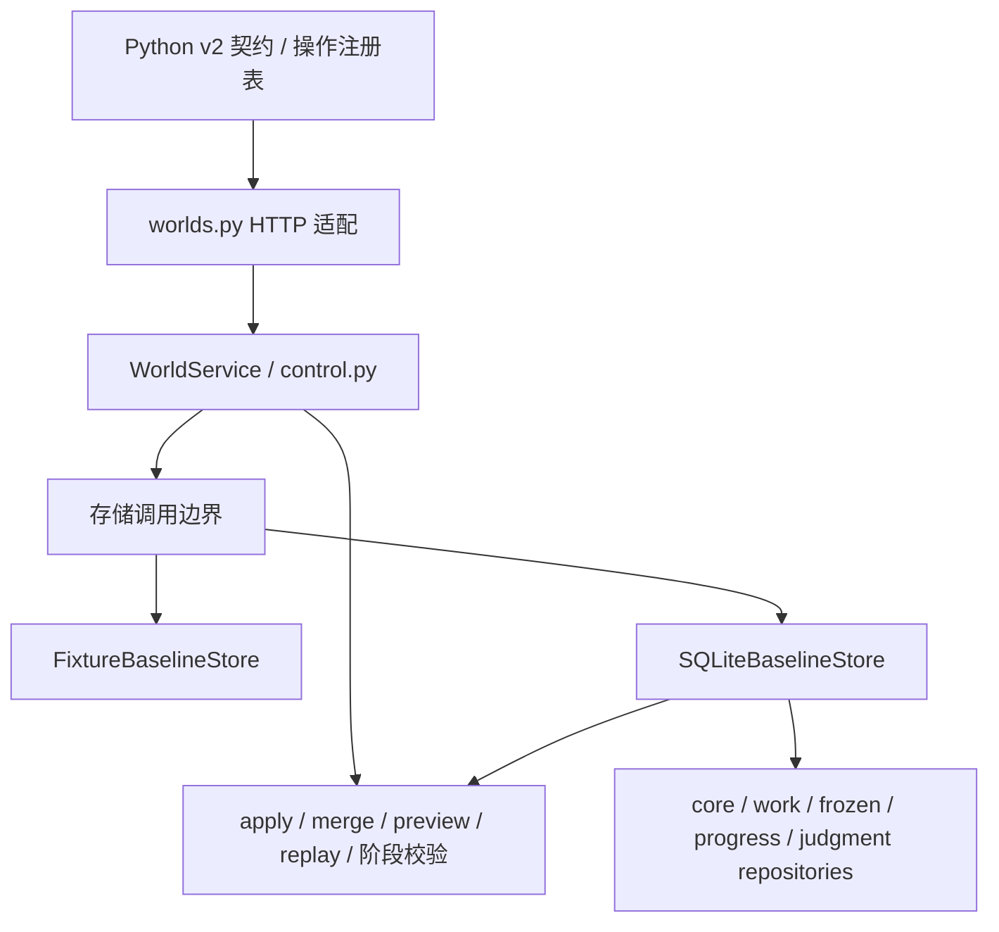
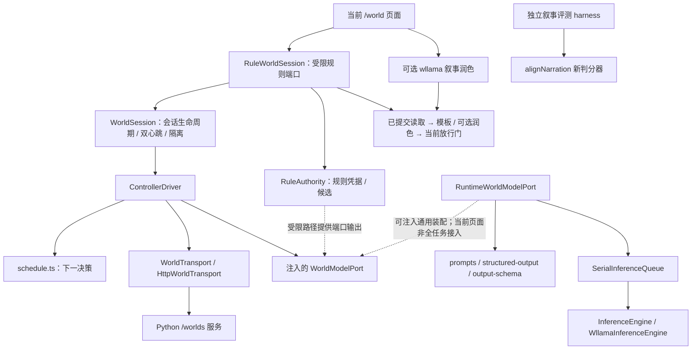

# 世界引擎组件边界核对与 C 分支任务筛选

> **后续方向更新（2026-10-28）：** 用户在本次核对后明确要求完全朝实现原设计发展，见[完整设计实施方向](full-design-implementation-direction.md)。本文保留源码现状核对；“待明确”的是组件实现与接线，不是可否删除原能力。C的辅助工具建议不能替代真实模型组件开发。

日期：2026-10-28。本文是现有代码的静态核对和排期建议，不是最终组件架构决议，也不新增运行验收结论。

## 1. 核对基线与结论

本轮读取两个实际工作树，而非把 browser 上缺少服务实现误判为 A 未完成：

| 开发线 | 核对提交 | 读取位置 |
| --- | --- | --- |
| A / `world-server` | `7f00a420ef4a2388a0d52f0d16aa665a9d21e259` | `.local/world-server-worktree/` |
| B / `world-browser` | `50c1c22968bcfec1bd292514efa9d7f613d16bb3` | 主工作树 |

核对开始时 B 工作树干净；A 另有未跟踪文件 `backend/_proj_create.json`，本轮未读取或修改。收尾时观察到 B 的并行改动：`page.tsx` 提取润色器到新增 `narration-polisher.ts`，以及新增 `frontend/scripts/run-world-chain-full.mjs`。本轮只查看这些改动的接线与脚本开头以区分正在进行的工作，没有修改、执行或验收它们；下文主体仍按表中已提交基线解释，源码链接的行号可能随并行改动移动。以下实现判断来自源码，既有验收状态来自关闭记录；未运行真实模型、服务或整链测试，未查询远端新状态。

**结论：服务协议和状态计算权威已有确定边界；浏览器内部有多种已实现的装配路径，但尚不能据此声称完整产品组件架构已确定。** 新的并行任务应依赖已冻结的外部读取协议，避免依赖正在组合的模型、规则和叙事内部接口。

用户本轮指定的 B 队列优先于旧文档：

1. 固定小世界、真实 Python 服务与浏览器模型，先完成普通行动点和连锁共同结算两个场景。
2. 记录逐任务格式错误、语义错误、重试、模板回退、实际调用次数与玩家总等待时间。
3. 首轮报告之后再排 20 次玩家输入、自动推进链、暂停恢复、历史回放和删缓存重生成。
4. 交付可复跑脚本、原始记录与问题清单，工作在 `world-browser`。
5. 页面继续使用当前放行门和模板；新判分门不是前置，新留出集等下一次规则冻结。

本轮没有收到 A 的新排期，不能因为 A3-2 已关闭就推断 A 当前空闲，或代替 A 分配新的实现任务。用户准备增加 C 的新安排优先于旧文档的“两条分支”约定；本轮仅核对并提出任务，没有创建分支或改写总分工。

## 2. 现有依赖与实际装配

### 2.1 服务端：状态计算和事务权威在 Python

以下路径按 A 提交解释，可用 `git show 7f00a42:<路径>` 核对。

| 组件 | 源码证据 | 已确定的职责 | 不能扩大解释为 |
| --- | --- | --- | --- |
| HTTP 与路由注册 | `backend/app/routers/worlds.py`；`backend/app/schemas/world/v2/registry.py` | 路径、操作、请求/响应类型及错误面来自注册表，HTTP 转交服务 | 已有对外插件框架 |
| 工作流与操作校验 | `backend/app/services/world/control.py:1305` 的 `WorldService`，以及 `ladder.py`、`authority.py` | 请求绑定、phase、门槛、幂等与操作执行 | 所有游戏语义、自然语言结果均已被证明正确 |
| 状态内核 | `apply.py`、`merge.py`、`preview.py`、`replay.py` | Python 实现状态变化、合并、预览、回放和摘要 | TS 可以再实现一套权威 apply |
| 两种存储 | `services/world/store.py`；`database/world_store.py` | fixture 与真实 SQLite 两条路径；SQLite 事务维护关联表一致性 | 已冻结可供第三方实现的 Store 插件 SDK；现有调用面仍含特殊 operation hooks |
| 服务启动 | `backend/app/world_app.py` | fixture factory 与显式配置数据库路径的 persistent factory | A 仍缺一个基本真实服务入口 |

`handle_get_state`（A 的 `control.py:1108`）在持久化路径调用服务端回放并与保存摘要比较；历史读取已经返回该点自己的前驱、时间和原始 Δ。无需另加回放接口才能实现只读诊断。

### 2.2 浏览器：通用控制器和当前页面不是同一种装配

虚线表示可替换/待选择的组合，不表示当前页面已运行完整真实模型链。源码依据：

| 组件 | 证据 | 当前用途与边界 |
| --- | --- | --- |
| 调度器 | [schedule.ts](../../frontend/src/lib/world-engine/schedule.ts) | 从服务态与控制器记忆导出下一决策；包含十类 `ModelTask`、六阶段更新、反应组与续轮流程 |
| 控制器 | [controller.ts](../../frontend/src/lib/world-engine/controller.ts) | 处理模型输出和服务响应，维护重试、身份分配、工作记忆与恢复；本身不绑定 wllama |
| 会话封装 | [session.ts](../../frontend/src/lib/world-engine/runtime/session.ts) | 接 transport、runtime port、driver factory；处理取消、双心跳和失租隔离，不定义游戏规则 |
| 真实模型端口 | [model-port.ts](../../frontend/src/lib/world-engine/runtime/model-port.ts) | 提示词 → 串行加载/推理 → 结构解码；有 `generateDetailed` 和 completion evidence，但不等于整链质量统计已经交付 |
| 当前页面会话 | [rule-session.ts](../../frontend/src/lib/world-engine/runtime/rule-session.ts:173) | 自建规则端口：固定单点计划；`targets=[]`；results 仅接受主角单人无骰点组；updates 来自规则凭据；continuation 固定 handback |
| 页面接线 | [page.tsx](../../frontend/src/app/world/page.tsx:305)、[world-defaults.ts](../../frontend/src/app/world/world-defaults.ts) | 新建和恢复都走 `RuleWorldSession`；默认世界和 policy 在代码中；模型用于可选叙事润色 |
| 规则判定 | [rule-facts.ts](../../frontend/src/lib/world-engine/runtime/rule-facts.ts) | 定向路线、两类任务里程碑与理智变化的受限规则；进程内凭据约束候选来源，不是服务端持久化授权契约 |
| 当前叙事 | [committed-narration.ts](../../frontend/src/lib/world-engine/runtime/committed-narration.ts)、[rule-session.ts](../../frontend/src/lib/world-engine/runtime/rule-session.ts:96) | 验证已提交读取的血缘和受支持变化，生成事实包、模板，润色失败重试一次再回退；当前门是 `checkFactNarration` |
| 实验叙事 | [narration-split.ts](../../frontend/src/lib/world-engine/runtime/narration-split.ts)、[narration-eval.ts](../../frontend/src/lib/world-engine/runtime/narration-eval.ts)、[narration-alignment.ts](../../frontend/src/lib/world-engine/runtime/narration-alignment.ts) | 分段表达实验及新判分器。`narration-eval` 调用 `alignNarration`，当前页面没有接入这条新门 |

因此，普通点和连锁共同结算的真实模型实验需要 B 显式记录所选装配。当前规则页面的验收、H2 的脚本模型恢复验收、B3 的逐样本模型评测，不能相互替代为完整真实模型可玩性证据。

## 3. 接口清单：哪些能作为独立开发依据

“已有接口”与“可独立依赖的冻结接口”分别判断。

| 边界 | 当前接口 | 证据与稳定程度 | 对 C 的约束 |
| --- | --- | --- | --- |
| 服务 wire | Python v2 schema、`api-contract.json`、`versions.json` | 有版本、摘要 pin 和既有共同验收；本轮确认两端 API 契约及世界 schema 字节一致 | 可固定版本作为外部消费者，不新增 wire 字段 |
| 历史只读 | `list_points({after,limit})`；`get_state({point})` | `ListPointsData` / `GetStateData` 是明确的契约类型；历史读取不用认领计算租约 | 最适合独立只读工具 |
| HTTP port | `WorldTransport.execute(operation, request, scope, signal?)` | 当前明确的 B 内部抽象；实现按共享 schema 验证请求/响应 | 可消费；不改其签名，不承担协议更新 |
| 推理引擎 | `InferenceEngine.load/complete/dispose/info` | 有适配器和测试，已实现取消/生成证据；属于 B 的当前运行层 | 新引擎适配仍需确认真实能力和组合要求，不能仅凭接口存在就推荐 C 接入 |
| 模型任务 | `WorldModelPort.generate(task,key,input:Json):Promise<Json>` | 任务联合类型存在，输入/输出仍主要依赖调度、提示词、codec 和运行时约定；不是逐任务的完整强类型公共组件协议 | 不适合 C 同时重构任务边界或并行扩展模型职责 |
| 游戏规则 | `RulePolicy`、`RuleProposal`、进程内 `RuleReceipt` | 仅当前受限规则路径；不在共享服务协议中 | 不能据此冻结通用规则组件或内容包格式 |
| 叙事组件 | `CommittedRead`、`CommittedNarration`、polisher 与两种判分门 | 页面和实验路径分开；当前事实包不是任意 v2 世界变化的通用表示 | C 不做新门接线、表达管线重构或新留出集 |
| 初始世界 | `WorldInitialTemplate` → `WorldInitialState` 引用校验 | 创建请求格式已确定；内容包、可执行规则、生成流程、编辑器和页面配置的组合未确定 | schema 校验可复用，但不能推导出“内容制作架构已确定” |

共同 pin：`902918016f2bf7eff4cd1afd52da4ca96defdb5ee4082f171fda987de86680c2`（取自 B 的 `contract-digest.json`；本轮未重新运行完整导出检查）。

本轮实际比较：

| 文件 | A/B 相同的 SHA-256 |
| --- | --- |
| `design/world-protocol/v2/api-contract.json` | `97a7aa1e8f32a42d0bfb56c5628bc3645b8cd5cfd73a26864501717fb19bb7b1` |
| `design/world-protocol/v2/world-protocol.schema.json` | `8fa805c8360b090cdf09b9daddeedf9dbd58dff809e22e46ba3373cb4967e58bd` |

这两项文件比对不能代替全部协议生成物检查，也不能为本轮新 A/B 头组合签署 H2 验收。

## 4. 待明确的架构问题与处理时机

下表是需要明确的边界，不是发现了已确认的运行故障。B 的首轮实验可以固定一个实验组合并记录局限，无需等待全部产品架构冻结。

| 问题 | 现有证据 | 应明确的事项 | 责任及处理时机 |
| --- | --- | --- | --- |
| 真实模型链如何装配 | 页面走规则端口，通用 driver 另有模型端口 | 两个场景各自使用哪个 session/driver、哪些任务真实推理、哪些固定响应 | B 在首轮脚本/报告中写明；不能让固定输出冒充真实推理 |
| 模型候选与规则凭据的关系 | 规则路径只有凭据可产出 updates；通用端口能把模型结果解码为候选；提示词也强调规则凭据 | 实验采用受限规则、通用模型候选还是混合方式；哪些校验能证明结构合法，哪些语义只能评测 | B 明确实验语义；若扩展权威规则或 wire，则由 A/B 对齐，C 不代定 |
| 叙事支持范围 | `projectCommittedNarration` 会拒绝物品/地点变化、外貌变化、部分任务/个性组合和复杂位置 | 首轮真实模型更新是否限定在现有模板支持范围；超出时如何明确记录失败 | B 在两个场景准备时核对；不能用接新判分门掩盖投影能力缺口 |
| 模型任务公共协议 | 多处共用 `Json`，结构/语义约束分散 | 是否需要逐任务输入/输出类型、共享验证和能力声明 | 从 B 首轮问题清单判断，当前不交给 C 提前重构 |
| 初始世界与规则配置的归属 | 初始模板已在 wire；policy 只在浏览器，恢复也使用当前页面 policy | 世界存档与 policy 版本如何关联；通用生成、手写定义和页面默认值如何组合 | A/B 后续架构决策；内容包和制作工具排在此之后 |
| 新叙事门与新数据集 | `alignNarration` 仍是实验门；旧 validation 集已参与校准 | 何时冻结规则、建立真正未参与调参的集、选择页面组合 | 按用户安排，B 拿到真实整链成本后另议 |

另一个实现限制：当前模型采样 schema 主要覆盖 action 与 updates；codec 的结构通过、服务的候选合法、模型的语义正确是不同层次。首轮报告需要区分，C 不应现在接手“统一模型质量框架”并改变 B 的统计口径。

## 5. C 能独立做什么

### 5.1 可开工的窄任务：只读世界历史诊断工具

这是新增工具建议，不声称用户已批准实现。它依赖已确定的服务读取协议，不依赖最终浏览器组件架构，且不接管 B 的整链执行和模型评测。

**使用场景：** B 的首轮报告发现“某点角色位置或任务不对”，开发者给工具一个服务地址、worldId 和 pointId，就能查看服务实际保存的原始 Δ、前后状态字段差异与血缘，不必重新跑模型或从页面文字猜状态。

建议 C 独占新增 `tools/world-inspect/`，实现 CLI；首批不增加页面、服务路由、共享类型、依赖清单或根级 CI 改动。

| 小批次 | 输入 / 输出 | 完成标准 |
| --- | --- | --- |
| C1：只读历史采集 | 输入服务地址、worldId；分页读取 `list_points`，固定一次采集的目标点集合，读取各点 `get_state`；输出带协议版本、来源和采集时间的诊断文件 | 超过 100 个点能读全，分页无进展时报错；并发追加不被误称为同一事务快照；不发送租约、claim、模型和写操作 |
| C2：单点诊断 | 输入目标点，展示身份、前驱、时间、服务摘要、原始 Δ，以及前后状态 JSON 路径差异 | 覆盖人物/物品/地点及任务、描述变化；根点单独处理；缺前驱/缺字段明示，不能假装空增量 |
| C3：脱离服务的查看 | 从已采集文件生成同样的文本或 Markdown 报告 | 不读取数据库，不启动模型；报告对原始字段提供来源路径，不经过叙事事实投影，完整保留未识别字段 |

边界约束：

- 只显示或比较服务返回的状态和摘要；不得自行实现 apply、规范摘要或 replay，也不宣称已独立证明状态语义正确。
- 字段差异不等于原始 Δ，原始 Δ 与前后字段差异分别展示；嵌套容器的隐含移动不能被伪造成直接位置增量。
- 使用完整 `get_state` 形状，不依赖 `CommittedNarration`，避免继承当前模板的支持范围限制。
- 不设计产品存档导入/导出格式；这里的文件只是版本化诊断产物，不保证可恢复成游戏。
- B 仍维护真实模型整链脚本、逐任务原始输出和质量/时延问题清单；C 工具只是辅助检查服务状态，不另做一套验收签字或推理统计。
- 只读 HTTP GET 不代表服务内部零写入；存储清理等副作用仍由服务实现决定，工具不直接操作库文件。
- 通过 mock HTTP 的允许操作列表、分页边界、缺失字段、根点和离线复现检查独立验收；有指定 A 服务后再做只读冒烟，不把它当作 B 的真实模型验收。

这条任务能成立的依据是确定的 `ListPointsData` / `GetStateData`：前者包含 pointId、sequence、kind、roundId、advanceId、stateDigest；后者包含 pointId、version、完整 state、stateDigest、previousPointId、timeAdvance、entityDeltas。所有数据都已有来源，不要求 A/B 先设计新接口。

### 5.2 当前不适合 C 开工的任务

| 任务 | 排除原因 |
| --- | --- |
| 真实模型两个场景、20 输入和成本报告 | 用户已明确归 B |
| 新判分门接页面、新留出集 | 用户明确延后，不改变优先级 |
| 通用内容包、世界编辑器、规则插件 | 配置、版本和行为边界尚未确定；此前推荐过早 |
| 新模型适配、模型任务协议或调度器重构 | 会直接触及 B 本轮排障与组合；当前收益不能仅靠并行人数判断 |
| 自然 TTL 接管、事务/存储重构 | 属于 A 核心职责；本轮没有 A 当前排期，不能保证独立，也不应重开既有 H2 冻结范围 |
| 容量优化与缓存方案 | 当前首要问题仍是一次真实输入能否完成、质量与等待成本；需要首轮测量后选点 |

## 6. 排期建议与核对范围

先由 B 完成已指定的两个场景首轮报告；A 按其队列维护服务边界。若现在增加 C，建议只认领 C1/C2 的只读诊断工具，依赖固定服务协议，独占新目录；不让 C 同时决定游戏规则或最终组件架构。若希望 C 直接承担新的可玩功能，应等上述架构问题和 B 首轮问题清单明确后再拆。

本轮交付为：现有组件图、接口稳定性清单、待明确事项和有源码依据的 C 候选任务。没有创建 C 分支、实现候选工具、修改 A/B 产品代码或扩展任何既有验收结论。

相关历史依据：[两人职责边界](../browser-world-state-work-split.md)、[A3-2 关闭记录](../../artifacts/a3-2-signoff-d1d2de0.md)、[H2 冻结记录](../../artifacts/h2-freeze-d1d2de0.json)、[页面验收](../../artifacts/world-page/signoff-552148c.md)、[原阶段 5 要求](../browser-world-state-workflow.md)。它们分别证明各自当时的范围，不替代本文记录的用户最新 B 队列。
