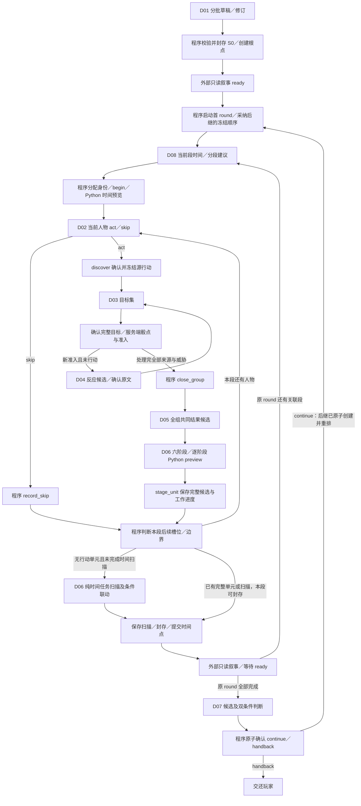

# D / L1：非叙事组件架构与程序、模型分工

日期：2026-10-29。状态：原 L1 架构已完成独立只读复核；现按用户 500 毫秒完整计算目标补充性能拆分方案并完成独立复验，无剩余文档阻断，待批次验收。全部组件能力状态为“仅方案”；没有毫秒级运行成绩。

## 1. 起点、证据与交付范围

本批从 D 分支 `world-components-logic` 的 `6ba4dc91677558276c6afe73398633a5e7cd6889` 开始；其父提交 `3a47915` 建立专项，继承 C 的 `3006935`。D 是工作树代号，下文 C1–C7、U1–U6 是继承的职责编号，不能据此计算模型数量。

本机独立检出位于 `/Users/sunhaitong/.codex/worktrees/components-logic-l1/jity`，启动时工作区干净。原主目录保留 `world-server`；没有迁入其环境、依赖、数据库、模型权重或运行产物。L1 只读源码与设计，不读取 B/C 的训练、开发、校准或封存样本正文，不生成本专项数据，不启动服务或推理。

| 依据 | 固定来源与用途 |
|---|---|
| D 任务与权限 | 本分支 [README](README.md) §2、§4–§9，根目录 AGENTS.md；L1 只交架构与分工 |
| 功能要求 | [完整原设计](../../browser-world-state-workflow.md) §3–§8、§11、§13；[R01–R16](../full-design-implementation-direction.md) |
| 继承草案 | 本基线 [C 接口](../components/component-contracts.md)、[模型与运行时方法](../components/model-training-runtime.md)；其候选和实验范围不是 D 的选型结论 |
| D 当前实际代码 | `6ba4dc9` 的 schedule/controller、模型端口/提示词/codec、Python schema；下文“D 基线已有”只指该树 |
| B 较新实现参照 | `90463b12eac989d4bd3c3bb8b3e2e54720177195`，只读对比运行代码；不复制其样本或产物，不自动合并 |
| A 服务参照 | `4e1702546df3337d28600b2caa55fb5ed86a5d83` 的 control、preview、units 和 schema；D 基线没有这些服务实现，不能据目录缺失断言 A 没有能力 |
| 协作称呼 | `agent@dd345b826b5f63ed0b9c530271cfb01a945de0ad` 的 [工作树记录](https://github.com/TandyBlow/Jity/blob/dd345b826b5f63ed0b9c530271cfb01a945de0ad/design/world-engine-reports/worktree-coordination.md)：A 既定服务成果已收口到 agent，B/C/D 继续独立；公共变更交协调人安排 |

L1 应回答“怎样拆、为什么拆、输入输出与谁负责、还有哪些接线缺口”。具体模型标识/权重、任务头、训练数据、阈值、运行时选择及比较协议由 L2 给出；质量和成本假设由 L3 实测。这里不选择固定七份模型，不把 C 的有限叙事实验迁移为非叙事能力证明。

## 2. 建议数量：8 个 D 软件组件

建议 **7 个核心语义职责域 + 1 个时间/分段辅助提议职责域，共 8 个对外入口**。其中 D06 内有六个有序、可单独测试和替换的阶段接口。8 是职责入口数，**不是最终性能微组件、权重或调用数**；各入口内部按性能需要拆分，不能为保持 8 个模块而保留超时的大任务。

| 编号 | 软件组件 | 对应继承职责 | 组成依据 |
|---|---|---|---|
| D01 | 初始世界草稿生成与修订 | C1 | 同一开局草稿及确认生命周期；内部仍分清单拓扑、实体定义、人物定义等步骤 |
| D02 | 普通行动判断与生成 | C2 | 指定人物的一次行动机会；act/skip 与行动内容须使用同一最新工作输入 |
| D03 | 冻结行动的目标分析 | C3 targets | 消费已确认源原文，输出完整目标集；确认后形成不可再采样边界 |
| D04 | 准入后的反应生成 | C3 reaction | 与 D03 之间存在服务端骰点/资格/准入屏障，输入和恢复点不同，独立成组件 |
| D05 | 封闭组的共同结果 | C4 | 全组一致性是一项联合语义任务，输入必须包含全组行动及全部判定 |
| D06 | 六阶段候选编排 | C5 / U1–U6 | 共用一个结算单元及阶段账本，但保留六个阶段的独立输入、输出和预览依赖 |
| D07 | 后续行动与继续判断 | C6 | 只有原 round 及关联段完成后才运行，候选生成与两个判断条件共同形成结论 |
| D08 | 时间跨度与点分段建议 | C0 的 time/pointPlan 辅助提议 | 世界语义决定跨度/边界建议；程序决定合法身份、点形态、锁定和执行顺序，不新增产品语义职责 |

**不计入这 8 个的既有外部边界：** A 的状态内核/事务/回放，B 的调度/输入装配/生命周期与接口适配，C/B 的只读叙事。D 可以设计其交接要求，不接管这些生产目录。

软件组件、阶段接口、模型骨干、任务头、实际调用分别计数。D02/D04/D05 等可共享生成骨干；判别任务可共享另一个骨干及不同头；D06 一次处理可触发多个阶段/批次调用。是否需要独立权重、是否分头及可否合并调用，本批均不冻结。

### 2.1 全局组织备选

| 方案 | 组织 | 优点 | 代价与采用条件 |
|---|---|---|---|
| 粗粒度 7 组件 | 将 D03/D04 放进同一反应域组件，保留两个阶段入口 | 模块较少，可共用组上下文 | 骰点屏障不能合并；目标已确认/反应未确认仍须分别恢复，容易混淆失败及重试范围 |
| **建议 8 组件** | 单独目标与反应，D06 保持一个六阶段编排器 | 与已确认工作边界一致；首批可独立比较 C2–C4；阶段依赖集中核对 | 内部适配与跨组件证据需要维护；不意味着比其他方案快，须在 L3 比较 |
| 细粒度 13 组件 | 在建议方案上，将 D06 的 6 阶段各拆成组件（8−1+6） | 专用头替换、阶段错误归因和异构运行更直接 | 更重的上下文传递/调用协调/加载切换；只有阶段质量或成本证据支持后再采用 |

开局若确需三套独立生命周期，可再拆 D01；当前同一草稿内分批生成/修订已能表达依赖，不先增加组件。以上数量都是 L1 建议，不是架构冻结或模型性能结论。

### 2.2 性能优先的微组件协同候选

用户已明确每个小组件与完整计算都要快；一次完整非叙事计算（含模型协同、程序交接）上限 **500 ms**。局部节点默认 50 ms 是本专项初始工程预算，不是用户另行规定的数字；完整计时与超时判据见 [验证协议](evaluation-plan.md) §7.1。即使每节点都达标，串行、递归、批次数和程序往返叠加后超 500 ms 仍不通过。下表是待测拆分图，不是已经达到这些耗时。

| 职责入口 | 优先比较的更小任务协同图 | 模型/程序与依赖 |
|---|---|---|
| D01 | 清单/拓扑提议 → 逐实体定义 → 逐人任务/个性 → 理智预测；草稿修订只重做未确认部分 | 小生成器与引用/覆盖检查分工；阶段之间有确认和依赖，不能并行猜后续事实。完整开局另列工作负载，未测不签全局速度 |
| D02 | 输入可执行性/自主行动需求判别 → 意图/引用选择 → 最小充分行动计划 → 短文本实现 | 小编码器头与小生成器协同；只有真实判定 skip 才省掉后续生成。任务/个性上下文不能裁掉；各步须计总等待 |
| D03 | 对完整候选分批关系打分 → 集合一致性检查 → 引用集合 | 共享小骨干多头/批处理可比较；未判完整不能固定空集。目标确认前无本关系未来骰点/准入 |
| D04 | 已准入威胁/任务约束编码 → 反应计划选择/生成 → 短文本实现 | 骰点/准入仍由程序先完成；头不能冒充会开放生成，原文冻结后不重算 |
| D05 | 全组冲突关系编码 → **全组统一后果计划** → 同计划下成员表达/结构化效应候选 | 共同计划保留全部冻结动作和实际判定；有条件的成员表达可批处理/实测并行，不可拆成互不知情的独立结算。语义后果由模型判断，程序核身份和一致性约束 |
| D06 | U1 引用选择；U2 变化判别/描述；U3 全任务批量评分；U4 小任务生成；U5 个性判别/描述；U6 受限数值预测 | 每阶段可有更小头或生成器；顺序 preview 及全覆盖不变，同阶段可合法分批。只在输入依赖允许且实测有益时并发 |
| D07 | 拟行动候选生成/选择 → 发生可能性与主角关联双头判断 → 程序组装结论 | 两个判断可共享编码结果/一次前向，不能把预测或预算耗尽当权威结束；全部关联段完成后才运行 |
| D08 | 中途事件/跨度依据识别 → 时间/分段提议 → 程序合法性核验 | 小分类/回归/生成候选并列，前缀和时间权威保持；不得用固定时间删掉语义职责 |

当前可比较的小模型来源是候选表中的约 10M 编码器与 77M 生成器；几十至几百 M 不是下限，允许新增更小的专用/蒸馏骨干或轻头，先补身份、训练数据和质量协议再试。较大通用生成器保留为质量/结构对照，不能因它是基线就默认成为最终方案。

任何节点或完整请求超预算，必须保存剖析记录并进入下一轮“更细任务 + 更小模型协同”比较；合法批处理、共享编码、短但语义完整的输出及设备上真正可用的并发可一并优化。若更细拆分仍慢，应继续调整瓶颈任务；不以拆分次数多、参数少或相对最快代替通过。所有候选都未达标时，结论保持“性能未通过/未验证”，不放宽原功能。

## 3. 完整执行流及确认边界



图中的模型步骤只生成候选，程序持有下列屏障；图不授予 D 任意跳转或提前写入状态的权限：

1. **开局身份与草稿。** world 创建前的初始登记/草稿键由程序管理，不能调用要求已有 worldId 的运行期 ids 端点来解释这一阶段。清单→位置/外貌→每人任务/个性→依据个性预测理智，允许修订；确认后通过现有创建模板校验封存，运行中不创建新人物/物品/地点。
2. **时间先行。** 当前段身份与基线确定后，begin 保存时间、Python 先应用时间再供行动/阶段读取；首次确认时间相关工作后锁定。同段各人物复用同一时间，不累计多遍。D08 的计划不等于已访问名册，未列人物仍需按实际冻结槽位判断。
3. **行动→目标→判定→反应。** 源原文先确认，再确认该源完整目标集（包括空集），再请求实际骰点。准入由程序裁决；D04 只生成仍未确认的新反应。DFS/来源栈、created/reused、威胁去重及既有判定使用正式恢复事实，成员数组顺序不等于处理顺序。
4. **闭组与共同结果。** 所有成员目标和相关判定完整、全部来源处理完成后才能闭组。D05 包括拒绝判定和已行动目标的判定；被牵连者不生成第二次行动，但判定可以影响本组结果。闭组成员和原文不因结果重试而改变。
5. **每单元更新与 stage。** D06 每个单人/共同组后运行；stage 保存完整结果和阶段候选，只提升工作游标。后续人物使用 Python 重算的新工作态；世界头及已提交进度只有 commit 才原子提升。冲突候选不能靠数组后写覆盖。
6. **段与 round 分离。** normal/instant/linked 是段形态，round 才是冻结顺序范围；关联段沿用顺序和 trigger，新 round 才按当时理智排序。同 round 已行动者不再行动，visited 与 acted 另行处理。
7. **提交、叙事与继续。** 每个完成点先提交，再由外部叙事仅读取该点/前驱原始记录；ready 之后处理原 round 的关联续段，全部完成才运行 D07。预算不足保存暂停；模型 handback、手动取消和暂停分别记录。

### 3.1 跨点预约的附加约束

默认采用已提交前段且叙事 ready 后才在下一合法点确认行动的串行路径。需要提前保存边界工作时，B 必须先使用既有 prepare_successor 封存前驱并固定后继的未来基线、pointId、instant/0 时间及输入绑定，**在该基线上调用边界行动**。前驱提交前只保存边界源行动/目标/程序判定；成员反应、闭组和共同结果等待前驱提交且 ready 后继续。

已经在旧点/旧时间确认的原文不能因模型后来发现多人关系而挪到另一个点。D08 对动态边界发现提出建议；若当前 B 输入/执行方案不能在确认前给出合法绑定，记录适配缺口并停止这一路候选，交协调人/B 完善，不回写时间、不复活原 ID、不默认取消重采样。D 不新增跨点复制协议。

## 4. 每个组件的输入、输出与程序/模型分工

### 4.1 共用契约

语义输入使用最近适用的 Python `workingState` 或明确的已提交状态；调用绑定由程序保留 world/advance/input/round/point/group、头/版本/摘要、revision、epoch、任务及阶段身份。只把语义需要的 ID/原文放进模型内容，授权 token 留在程序侧。

输入还须保留任务/个性原文、结构化及展开空间关系、当前有效描述和必要固定登记表；上下文不足时分批或停止，不能裁掉要求覆盖的人物/任务。工作态消费状态和已提交消费状态须明确区分，见 §7 的 G03。

**D02 的目标消费语义按完整原设计 §5.1/§6.1：** pending 时主角仍需重新判断输入能否执行；consumed/expired 时正文只作触发背景，不重做命令。NPC 按自身任务/个性自主判断。主角在首 round 的输入机会经 act、skip 或被迫反应占用后才置 consumed，这表示机会已处理而非命令成功；后续 automatic round 继承 consumed，取消/交还时仍未处理的输入按服务结论结束。现有服务的历史约定与此有差异，见 G03；不能简单改读 working 状态就声称已对齐，也不能由 D 在客户端覆盖服务事实。

内部组件结果统一区分三类（只是架构语义，不增加 wire/schema）：

- **已完成的肯定候选**：可以进入对应结构/引用及语义审核。
- **已完成的合法否定**：skip、空目标、阶段无变化或 handback，附本次完成范围的内部记录。
- **未完成**：缺资料、截断、格式/引用问题、无法判断、超时、取消；停止采纳或按预算重试，不自动改成否定。

实际输入分组、输入身份、完成返回、模型/配置身份、解码和审核结果属于实验/本次调用侧证据，不直接进入闭合模型 codec、世界 Δ、服务请求或长期人物知识状态。程序补全名单只能证明结构装配，不能证明模型检查过该名单。

### 4.2 逐组件说明

| 组件 | 必需语义输入与候选输出 | 程序完整承担 | 模型必要性/形状与无模型边界 |
|---|---|---|---|
| D01 开局 | 设定/规模、已有草稿登记和已采纳批次 → 清单拓扑、全部初始位置/描述、逐人任务/个性及依赖理智草稿；最后适配 WorldInitialTemplate | 草稿身份、重复/覆盖/引用、位置图/任务树校验、修订版本及确认封存 | 分批生成并核对设定语义；固定手写世界仅是控制参照，不完成通用开局。单批失败可修订，不能改已封存 S0 |
| D02 行动 | 时间已应用的最新人物/空间/物品/任务/个性、主角身份、advance/input 与正确的当前消费语义 → skip 或 act(text)，依据可留内部 | 当前槽位/行动资格、输入绑定、非空及引用校验、发现组与原文冻结 | 判别/评分＋条件生成；主角可执行性及 NPC 自主行动需要语义判断。命令解析或固定 NPC skip 只能作参照 |
| D03 目标 | 当前源 ID、已确认行动逐字原文、工作状态和完整候选人物/组上下文 → 完整目标 ID 集；当前 codec 降为 targets | 人物引用、去重、trigger 分配、确认空/非空目标、固定判定键及实际骰点 | 关系分类/多标签/逐候选评分，或生成引用集合；不能靠已行动名册抹掉仍影响结果的关系。缺原文/范围未检完是未完成 |
| D04 反应 | 被准入人物、源威胁原文、实际完整判定、组内冻结行动与人物任务/个性/工作态 → 非空反应候选 | eligibility/admission、是否已有行动、唯一接受关联、冻结、DFS 推进和恢复 | 条件生成，可加内部计划；已准入不决定具体反应文本。已有确认行动直接复用，原文缺损明确停止 |
| D05 结果 | 闭组全部成员的原文、全部已定稿判定/规则/资格、结算前状态 → 全组一致的结果候选及当前按成员 ID 的 results | 闭组完整性、成员精确覆盖、引用与候选身份校验；原文/roll 不变 | 联合条件生成，可先建全组结果计划；程序不把固定成功/失败短语当共同因果。未知实体意图须在语义上处理失败/部分后果，提交仍拒绝未知 ID |
| D06 更新 | 当前阶段 Python 投影、完整结果（纯时间无 results）、允许字段/完整检查范围 → 六阶段局部候选及实际完成记录，适配 SettlementGroup | 阶段编排、覆盖对账、ID 分配重写、引用/图/任务树/数值校验、preview、stage、合并/commit | 各阶段的分类、抽取、引用选择、生成和数值预测；固定 Δ/理智增减只能作参照。具体六阶段见 §5 |
| D07 继续 | 主角、完整当前世界、当前 round 全部已提交点的时间/原始 Δ，程序掌握当前链身份 → handback 或候选人物/拟行动及两个判断依据；适配正式 conclusion | 全历史读取/血缘/完整性、候选合法、nextRoundId 分配、原子结论、输入继承/新顺序/预算暂停 | 候选生成＋发生可能性/主角关联两个判别；依据用于本次语义评测，不落长期历史。缺历史不当空历史，未判断不当 handback |
| D08 时间/分段 | 当前世界/时间、输入背景、冻结顺序/剩余槽位、段形态、已确认前缀/预约 → 时间跨度及分段建议、内部覆盖/依据 | ID、normal/instant/linked 约束、时间应用、锁定/取消、前缀/未来基线核验、已处理集合 | 时间/事件跨度与明显中途关联行动需要语义提议；固定时长/固定计划仅为控制参照，不覆盖开放场景。计划不替代逐人物判断 |

这 8 项是设计接口；并非声称当前生产调用已提供表中全部输入或验证过对应能力。缺口逐项交接见 §7。

## 5. D06 六阶段与完整覆盖

| 阶段 | 实际输入/覆盖 | 语义候选 | 程序职责及进入下一步的条件 |
|---|---|---|---|
| U1 位置 | 本单元结果及当前空间图；所有人物/物品 | 新 container/slot/relative 引用，或逐对象无变化 | 登记实体/槽位、最终联合图无环、同时移动与相对依赖；Python preview 后才给依赖新位置的 U2 |
| U2 外貌 | U1 后投影及完整结果；人物/物品/地点的初始及有效外貌 | 新描述/替代引用/纯解除或无变化 | 初始原文不可改；只引用合法有效旧变化，草案引用按现有程序适配；preview |
| U3 任务达成 | U2 后投影、已推进时间；**所有人物的全部当前任务**，含此前单元新增任务 | 每个受检任务达成/未达成 | 逐批覆盖对账、任务归属、依赖与合法当前 ID；小任务完成不自动令根任务完成；preview |
| U4 新小任务 | U3 后状态、已有任务树、判断依据/完整结果 | 有助于父目标的小任务草稿，或确认无新增 | 不新增独立根，不跨人物/成环；草稿定义及引用由程序分配/重写；本阶段新增状态 pending；preview |
| U5 个性 | **本单元存在新达成任务时扫描全部人物**，含场外人物；U4 后任务及有效个性 | 变化/纯解除/无变化，允许所有人都无变化 | 检查触发、实际全名册覆盖和 supersedes；缺任务触发不能更新；preview 提供新有效个性 |
| U6 理智 | 仅 U5 中个性实际变化的人物，含纯解除；新有效个性与状态 | 最终 0–100 整数预测/受限分类或回归映射 | 核对对应人物集合与整数范围，非法值拒绝，不静默 clamp；无个性变化不自动恢复，不从事件直接扣数值 |

阶段账本至少记录该次权威输入、预期对象集合、实际输入批次、完成返回及问题，留在调用适配/实验层。原有候选 coverage 名单不能充当模型扫描证据。分批须覆盖同一阶段要求的完整集合，局部失败不能拿空 changes 补齐后 stage。

**纯时间点：** U1/U2 明确无操作；U3 用推进后时间完整扫描，U4 继续判断小任务，U5/U6 按新达成/个性触发执行。完成这些检查后才可判实体 Δ 为空；保存时间、提交点并产生外部叙事，不是零成本路径。

**候选与最终编码：** stage 的新任务先为 pending，只有后续真实扫描才可达成；同点新增又达成在最终 Δ 仅以 subtasksAdded 的最终 achieved 编码，不再放 tasksAchieved。同点描述临时变化由 Python 合并折叠，不往 supersedes 写同点引用。stage 与 commit 各自复算/验证，D 不另做 apply。

**合并调用的采用条件：** 参考路径按六阶段依赖组织，批量和合并只是可比较的实现。位置影响外貌时必须先 preview U1 再生成 U2；任务、个性、理智依赖也须有可核输入，不能因 JSON 能容纳所有字段便默认一次完成。任何合并臂都保留程序阶段应用与完成覆盖，并在 L2/L3 登记哪些依赖允许合并、哪些需要独立调用；本轮不预先冻结 U5/U6 一次调用。

## 6. 逐职责备选、共享和成本假设

| 职责 | 方案 A | 方案 B | 取舍及后续可否证假设 |
|---|---|---|---|
| D01 开局 | 一个生成骨干，按有序草稿批次生成/修订 | 将清单拓扑、实体定义、人物定义分成独立软件组件/可独立模型 | 分批降低单次输出规模，两者均保留用户确认及修订；独立组件增加草稿一致性成本，L1 暂保留单组件内分批 |
| D02 行动 | 同调用返回 act/skip 与条件文本 | 判别/评分头先判断，act 才调用生成器 | A 少一次交接；B 可能节省 skip 成本但假阴性会直接压掉行动。L3 要单列错误跳过及全链成本 |
| D03 目标 | 生成骨干输出目标引用集合 | 对完整候选人物逐对/批量关系打分，再组装集合 | B 可定位漏标/误标但要完整候选与标签；A 要核引用/遗漏。不能仅比较 JSON 成功率 |
| D04 反应 | 单次条件文本生成 | 先给反应语义计划，再由共享骨干实现文本 | B 更便于审查约束/原因，却多调用和错误传播；两者都只在真实准入后执行，不生成备选已发生事实 |
| D05 结果 | 全组一次联合生成 | 全组统一结果计划，再依同一计划输出按成员覆盖的文本 | B 可独立定位冲突，但规划错误会传给全部成员；禁止互不相干的逐人自由结算后拼接 |
| D06 更新 | 六个有序阶段接口，按上下文分批 | 经依赖判定的条件合并/共享判别头 | B 可能减少生成调用，也可能增加重复输入/对账；强依赖必须拆分，全任务/人物覆盖不变 |
| D07 继续 | 同一次调用给候选拟行动和双条件依据 | 候选生成后分别判“很可能发生”“与主角有关” | A 少调用但两种误判纠缠；B 可独立查误续/漏续但传播候选偏差。概率/相关判据和阈值留 L2 登记 |
| D08 时间 | 直接生成跨度/段建议并核验 | 先识别中途事件/分段需求，再提跨度 | B 增加调用但可查跳过关联事件；计划仍须与真实边界、锁定和预览一致，不能猜全组后再重绑已确认原文 |

可共享的是模型能力与权重，不是已确认结果：生成域可覆盖行动/反应/结果/新描述；判别域可覆盖 act/skip、目标关系、任务达成、个性触发及继续判断；U6 另比较整数生成、受限分类/回归。是否共享、任务头是否冲突、是否需要容量对照均待 L2/L3，不引用 C 的别任务耗时来承诺收益。

一个玩家输入链的账本至少分别记录：

```text
模型调用 = 开局相关 + 时间/分段 + 行动 + 目标 + 反应 + 共同结果
         + 各单元六阶段各批次 + 纯时间扫描 + 继续判断 + 外部叙事
         + 重试/重生/语义复核
程序往返 = ids/确认工作/roll/preview/stage/commit/恢复及独立心跳
等待 = 加载/切换 + 各阶段串行推理与传输/校验 + 各段叙事门槛
```

实际账本以事件计数避免分类重复；不开局时开局项为零，阶段无触发有明确完成依据。冷/热、首 token、p50/p95、输入输出量、峰值内存、取消/失败/回退分列；共享模型可能省加载却增加重复上下文，多个小模型可能增加常驻/切换成本。离线和浏览器分别测量。

原设计 §11.3 七单元的 7–14 次六阶合并调用、26–35 次总量是带条件历史估算，不作为 D 的固定调用数、全局上限或通过阈值。

## 7. 当前源码事实与接线缺口

以下只做静态核对；“待核对”不冒充已经复现的线上故障。B 较新变化单列，不混入 D 基线能力。D 本轮不修改 A/B 源码或闭合 wire。

| 编号 | 代码事实（固定版本） | L1 交接要求 |
|---|---|---|
| G01 开局 | D `schedule.ts` 的 initial 调度给 `input=null`；当前完整 initial 模板出口没有草稿批次/修订确认生命周期 | B 后续装配设定、草稿登记、修订与确认；创建前身份与运行期 world IDs 分开处理，D01 内部草稿不扩展正式存档 |
| G02 点计划 | D pointPlan 输入仅 round/head；计划涉及身份、人物覆盖及时间，不能据它替代逐人物 act/skip | D08 给出语义所需状态/输入/剩余槽位契约；B 核对实际可用字段与身份适配，在冻结工作前确定合法点基线 |
| G03 输入消费（两层差异） | ①D/B actionAdvance 读取已提交 world.advance.intentStatus，working 可先于 commit 变化；②A units.stage_working/skip_working 对任意人物首单元/skip 即消费 pending，注释明确这是历史约定、主角规则 deferred；原设计要求由主角机会触发 | D02 目标规则按原设计，交协调人安排服务/消费层共同核对“谁触发消费”及“读取哪个时点”。不能直接换读 working：主角前 NPC skip 时会先消费。旧约定/轨迹不可由 D 静默改写，L1 不修改公共源码，也不宣称已跑出重复消费故障 |
| G04 阶段预览 | D schema 的 SettlementGroup 仍在 wire 层限制个性/理智成套与任务前置；A@4e17025 已把最终采纳规则放在 units.validate_unit，partial preview 可容纳中间阶段 | 联调需使用匹配的 A 参考契约/适配层，不能只看 D 目录断言服务缺能力，也不能声称 D 旧 schema 已原生匹配所有 partial preview；公共同步交协调人 |
| G05 真实覆盖 | D 已有六阶段列表、split 阶段调用与 preview；默认 updatesStages 为空时走 batch。codec 检查 stage 名及 EntityDelta 结构，未强制阶段字段归属/全部六阶段；候选 coverage 可由程序填全名册 | D06 需要内部实际批次/完成账本及阶段字段约束，验证无变化也确实受检；映射到现有 codec，不向 wire 直接塞依据/置信分数 |
| G06 新身份 | D ControllerDriver 已对 stage_unit/time_scan 的 change/task 定义及引用收集槽位、服务分配后重写；preview 可使用局部草案身份 | 保留该适配能力，不误写“没有 ID 适配”。pointPlan/initial/continuation 的草稿到程序身份需分别核对，不能把已有 change/task 重写推广为任意任务通用重写 |
| G07 继续上下文 | D recovery 已通过 list_points/get_state 恢复本 round 的原始提交变化并接入 controller；旧“H2 再补”注释不代表缺实现。当前 continuation codec 仍消费正式 conclusion/nextRoundId | D07 语义候选/依据与正式 conclusion 分层，拟行动和两种依据留内部；程序分配 nextRoundId。B@90463b1 已有 RoundIdentitySink 在确认 continue 后补新 round point/group 身份，但这不等于已经通用重写模型 nextRoundId |
| G08 固定与语义 | 原设计和继承方案有固定命令、固定时间、脚本结果和模板作为参照；结构 schema/服务校验不会证明自然语言因果 | L2 分开登记结构门、语义门、成本和覆盖。D03/D04/D05 必须看全部冻结原文与实际判定，不把 rollId 当完整骰点事实 |
| G09 调度输入与实际 prompt | D model-port 还经过 encode/focused 投影再推理；focused action 裁人物/附近实体，focused sanity 缺新有效个性上下文 | 核对最终进入模型的内容，不能只检查 schedule 对象。上下文裁剪须满足该阶段所需信息与覆盖；U6 缺新个性时停止该候选，不把 C 的叙事方向表达当数值预测 |

实际 source/target/reaction/results 的输入字段与缺项，在本稿审计附记中绑定具体函数；需求表是拟议充分输入，不宣称现有 generate 调用已全部装配。

## 8. 原要求覆盖与继承差异

| 原要求 | D 的承接与外部交接 | 依据 |
|---|---|---|
| R01 固定实体/任务子树 | D01/D05/D06；程序登记与图/树引用，运行不增实体 | 原 §3、§4.2 |
| R02 广泛状态/嵌套位置 | D01/D02/D06/D08 输入保留物品/地点/slot/relative，容量不足分批 | 原 §3、§5.2 |
| R03 初始不可改/变化历史 | D01/D06 使用合法追加/解除，不覆盖 S0 | 原 §4.1 |
| R04 S0+Δ 权威 | D 只提候选，A preview/apply/回放；上下文摘要是派生 | 原 §2、§9.5–§9.6 |
| R05 每实体合并 | D05 联合结果、D06 单元阶段；Python 合并与等价校验 | 原 §4.3、§6.3 |
| R06 冻结顺序 | D02/D08/D07 使用程序槽位，关联段不重排，新 round 重排 | 原 §5.1、§5.3、§8.1 |
| R07 牵连与先冻结全组 | D03/D04/D05 跨确认屏障，闭组后才共同结算 | 原 §6.2 |
| R08 已行动者与骰点 | 不生成第二行动，仍把所有判定传 D05；已接受关系复用 | 原 §6.2 |
| R09 六阶段完整性 | D06 U1–U6、全任务/人物覆盖、纯时间及条件联动 | 原 §6.3 |
| R10 继续双条件 | D07 分别核两条件；预算暂停、关联段和新轮分开 | 原 §8.1 |
| R11 只读选择性叙事 | 外部 C/B 消费正式目标点/前驱/原始 Δ；D 不从文本补事实，保留 gate 交接 | 原 §8.2 |
| R12 无人物知识真值 | D02–D07 从当前世界判断；不另建长期知识库 | 原 §7.3 |
| R13 无长期行动史 | 行动/反应/拟行动仅当前工作和明确实验记录；已确认工作按服务恢复 | 原 §6.1、§9.4 |
| R14 职责/模型/调用分列 | §2 数量方案、§6 共享/成本；不预定权重数 | 原 §7.1、§11.3 |
| R15 分批开局 | D01 草稿批次→修订→确认封存，完整接线后续安排 | 原 §3.3 |
| R16 可玩整链 | L2/L3 证据交 B；20 次输入/自动链/共同结算/恢复/历史由后续真实整链验收 | 原 §10 阶段5、§11 |

### 8.1 必须澄清的继承资料

- C 接口 §8 C5 中的“clamp”与同文 U6、原设计 §6.3 的拒绝非法值规则不一致；D 按后者设计。C 叙事中“方向由程序给定、模型只需表达”只证明其表达任务的分工，不能替代 D06 理智数值预测。
- C 模型/运行时表的“已定/不重开”是该专项和设备的历史选择；D 任务明确要求独立分析，L2 再查官方来源和锁定实现，L1 不继承为最终选型。
- C 模型表旧“微调后质量未验证”与同文有限 N4 离线通过状态并存；只按明确支持范围引用，不推导行动/共同结果可用。本轮不改 C 原文，向协调人交接这份差异记录。
- 结构草案、正式 wire 和原设计示意字段分开：以实际固定版本 schema/服务实现核对接线，不能把示意的 RoundCheckpoint/PendingGroup 字段直接加进现有协议。

## 9. L1 边界、后续假设与验收交接

| 尚待证实的假设 | 后续批次应如何处理 |
|---|---|
| 8 职责入口内部微组件能同时满足质量与毫秒预算 | L2 固定比较条件；L3 逐瓶颈继续拆任务/换更小模型，记录完整关键路径、错误传播与总成本，不以 8 固定微组件数 |
| act/skip 与目标/全局任务扫描适合判别头共享 | L2 选少量候选/数据协议；L3 看漏判/误判及联合能力，不能复用 C/B 标签或旧阈值 |
| 联合结果规划有助于冲突一致性 | 在独立的新来源数据中预登记全组/冲突/缺资料检查，比较同输入的直接生成与规划方案 |
| 阶段合并能减少等待 | 同时保留可合并与必须拆分的依赖路径，报告实际阶段输入、覆盖、preview 次数与失败 |
| 当前模型输入足够 | 先由 B 按 G01–G09 核对装配/上下文/身份，缺资料先明确未完成，不能靠提示词宣称已有字段 |

L1 的验证是需求覆盖、源码定位、组件计数/依赖、文档链接和独立审查；没有模型训练/推理，不宣称语义准确率、耗时收益或任何新组件已接线。L2 再建立独立来源登记、去重/同源人工复核、标签/指标/失败处置及少量候选；L3 首批深入 D02–D05，随后 D06/D07，D01 完整生成接线按原排期靠后。D08 的时间与边界约束在这些批次一直保留。

接线/公共接口/资源变更交协调人，生产目录分别由既有负责人处理。本稿不改变 H2 冻结、当前叙事门、状态权威或世界协议。独立审查者核验 L1，相应批次的最终验收由协调人/用户决定，实现者不自行签字关闭全部专项。

## 10. 源码定位附记与复核记录

### 10.1 D 基线的真实任务入口

以下行号均绑定 `6ba4dc9`，路径相对仓库根；可用 `git show 6ba4dc9:<path>` 复核。它们是静态源码事实，不是输入充分性或模型质量验收。

| 任务 | 调度输入及位置（frontend/src/lib/world-engine/） | 当前闭合输出/程序边界 |
|---|---|---|
| initial | schedule.ts:441–449，input=null | runtime/structured-output.ts:196–206 模板七字段顶层；深层引用在 Python WorldInitialTemplate 校验；完整草稿生命周期仍待适配 |
| action | schedule.ts:705–761，actor/advance(inputText,intentStatus)/workingState | codec:135–143 的 act(text)/skip；discover/record_skip。NPC 也逐槽询问，未默认为 skip |
| targets | schedule.ts:885–889，sourceId/actionText/workingState | codec:144–152 仅 targets[{targetId}]；schedule:830–863 程序按组/来源/目标分配 trigger 并确认，完整组/资格上下文未进入此 payload |
| reaction | schedule.ts:894–900，sourceId/sourceActionText/memberId/rollId/workingState | codec:239–244 非空正文字符串；schedule:865–881 绑定入向 rollRefs 后确认。已有冻结威胁原文，当前缺完整判定数值/规则包 |
| results | schedule.ts:966–985，全组 memberId/actionText 与 rollRefs(targetId,rollId,result,eligible,admitted)、workingState | codec:154–159 角色→文本；完整成员键由 StageUnitRequest.named_group 强制。controller.ts:694–705 缺原文停止，并保留拒绝/已行动目标判定；规则/阈值等完整事实仍须按新组件输入核对 |
| updates | schedule.ts:916–931、988–991，group/results/workingState/stage 或 time_scan 的 workingState/stage | codec:161–178 支持 batch 数组/split 单对象；controller.ts:399–528 的 preview 使用前序候选，不能让模型自行 apply |
| continuation | schedule.ts:584–615，round/head/workingState/有序 roundChanges | codec:180–195 正式 Conclusion（含 nextRoundId）；附加拟行动/双条件依据需要内部适配，不直接塞进正式 conclusion |
| time | schedule.ts:790–806，预约后继路径的 head/workingState | TimeAdvance→successorTime→prepare_successor；不能当成完整普通段规划入口 |
| pointPlan | schedule.ts:618–643，round/head | codec:209–223 非空 pointId/kind/timeAdvance/actorIds 列表；schedule:690–702 对未覆盖槽位仍继续询问，遗漏不等于 skip |

共同端口 `runtime/model-port.ts:69–103` 为 encode→队列→推理→decode，`runtime/prompts.ts:73–95` 可以启用 focused 投影；`runtime/focused-input.ts:26–54` 是 G09 的实际裁剪位置。

### 10.2 已有机制与固定外线差异

- **草稿身份并非一概缺失。** D `controller.ts:237–318` 的 collectCandidateIdentityWork 在 stage_unit/time_scan 前收集 change/task 定义、分配并重写 tasksAchieved/parentTaskId/supersedes；恢复候选原样发送。它不等于 initial、pointPlan、continuation 的通用身份适配。
- **恢复并非待从零实现。** D `recovery.ts:239–307` 用 list_points/get_state 恢复有序 roundChanges，`controller.ts:116–128` 采纳冻结工作；schedule 中旧 H2 注释不作为缺口证据。已确认原文/判定/候选直接恢复。
- **现有取消与隔离需要复用。** D `schedule.ts:421–435,473–488` 区分预算暂停/控制命令；`runtime/model-port.ts:65–110` 和 `runtime/session.ts:142–171,242–285` 已有 AbortSignal、epoch 隔离及迟到丢弃。组件不能绕过这些路径自行把过期输出采纳到新世界。
- **最终采纳与阶段预览分开。** [A units.py:46–56](https://github.com/TandyBlow/Jity/blob/4e1702546df3337d28600b2caa55fb5ed86a5d83/backend/app/services/world/units.py#L46) 放完整单元的配对/任务前提；[control.py:957–979](https://github.com/TandyBlow/Jity/blob/4e1702546df3337d28600b2caa55fb5ed86a5d83/backend/app/services/world/control.py#L957) 与 preview.py:22–35 从权威基线预览请求阶段列表，不累计上次 preview 或偷偷推进 revision。D 旧 work.py:47–50 的 wire 配对限制与之不同。
- **服务端权威继续保留。** A judgments.py:45–99,118–179 和 progress.py:43–79,104–143 管类型身份、判定去重及接受因果；control.py:641–650 与 timing.py:30–43 管点形态/时间；canCompute 是当次投影，下一写仍重新核权。
- **消费差异分规则与视图两层。** D schedule.ts:709–713 读取已提交 world.advance；A control.py:270–277、1037–1040 与 units.py:101–136 表明 working 消费先于 commit 提升。同时 units.py:107–109 明确记录“任意人物的首结算消费，主角措辞 deferred”，skip 也对任意人物消费；与原设计 §5.1:371、§6.1:451 的主角机会规则不同。这是已确认的静态规则差异；其运行后果与兼容修订未测试，G03 交协调人/A/B 处理，不由 D 重解释已冻结事实或改写服务。
- **较新 B 已有新轮身份补齐。** [B controller.ts:24–32,110–158](https://github.com/TandyBlow/Jity/blob/90463b12eac989d4bd3c3bb8b3e2e54720177195/frontend/src/lib/world-engine/controller.ts#L24) 的 RoundIdentitySink 在服务确认 continue 后分配下一 round 的 point/group 并合并身份 delta；D 尚未继承。正式 conclusion 本身仍由服务持久化，只有附加拟行动/语义依据不进入长期事实。

### 10.3 本批复核记录

需求与代码分别由两名只读审计代理核对；第三名独立审查代理完整复核 L1 稿及固定源码，发现 1 项 P2：G03 只提视图时序，未明确服务历史消费规则与原设计的冲突。修订后 D02、G03 和 §10.2 分别写明目标规则、现状证据及协调责任；审查者再次复核确认原 P2 消除、L1 文档无剩余阻断。

文档检查通过：本批两文件的 20 个本地链接可解析；8 个组件、R01–R16 的 16 项覆盖及 U1–U6 的 6 阶段均唯一齐全；代码围栏配对、`git diff --check` 通过；只有 D 专项设计目录变更。此检查验证文档完整性，不证明模型或服务行为正确。

本轮没有运行模型、服务或产品测试，没有读取/构造训练与评测数据。G01–G09 是接线/澄清清单，尤其 G03 的现有规则差异未在 D 修复。独立审查结论限于 L1 架构文档，最终批次验收仍交协调人/用户。
