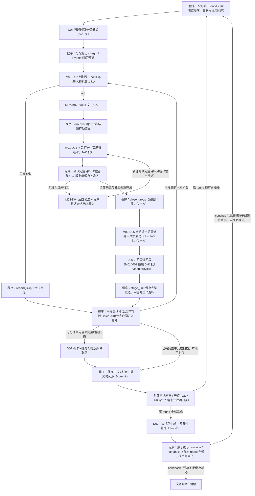

# D / L2：模型候选、共享方式与运行路径

日期：2026-10-30（Asia/Shanghai）。版本：L2-r3（同日两次复审修正：①恢复行动/目标/反应确认冻结与闭组后一次结算屏障，D07 移到各点提交、叙事 ready 且原 round 及全部关联段完成之后，D08 回到段起始适用位置；②补回 skip → 槽位/边界判断边，最小调用数与预算改按"每个冻结源各一次 D03"逐项清点——范围链 370 ms、完整单段轮 630 ms+W_r、含一次自动后续轮 1260 ms+2×W_r）。按总指挥 2026-10-30 指令修订排期：**取消"必须先跑 M04/0.6B 对照"的前置**，优先论证并实测小编码器、短文本生成与程序的协同分工（见 §7 修订与新增 §8）；候选身份、来源登记与性能纪律沿用 r2，r2 的独立复验范围继续有效。本批状态为"仅方案"：锁定候选的公开来源身份及比较路线，没有下载完整权重（M02 除外，已验真）、加载模型、训练、推理、浏览器验证或生产接线；毫秒级性能尚未验证。

依据：[专项任务](README.md) §5–§8、[L1 架构](architecture.md) D01–D08 与 G01–G09。判据、数据纪律、比较臂及报告要求见 [验证协议](evaluation-plan.md)。L1 已独立复核；用户本次授权继续 L2，不代替协调人对跨线接口的裁定。

## 1. 本轮建议及选择理由

**最终选型原则：在完整质量要求下尽量缩短实际等待，每个小组件和完整计算都要快。用户已选定完整一次非叙事计算（含模型协同和程序交接）在 500 ms 以内。** 较慢方案必须继续拆任务、换更小模型协同并实测，不能仅因比基线快或省内存而验收。计时及局部工程预算见验证协议 §7.1。

现登记 **4 个候选身份**，供建立质量对照与小组件比较；它们不是最终数量上限。每项语义需求从适配路线比较，不训练四套全功能系统，也不为 8 个职责入口各配一个大模型。几十至几百 M 是当前探索范围，允许更小的专用骨干/任务头；新身份先登记来源、训练和运行协议，再纳入同条件比较。

- **M04 / Qwen3-0.6B：真实生成对照。** 继承现有生成思路，在 D 的全新数据上重新测；不借用 B/C 的权重、样本、缓存、阈值或历史成绩。用于定位质量/结构问题，不预设为最终运行骨干；超预算即不能作为达标方案。
- **M03 / Qwen2.5-0.5B-Instruct：几百 M 的指令生成备选。** 与 M04 同属因果生成路径，少一类运行时；用同语义输入测试较小骨干是否够用，不据规模直接断言更快。
- **M01 / MiniRBT-H256：小判别骨干候选。** 面向 act/skip、目标关系、任务达成等打分；需要本专项监督及任务头，原始 MLM 检查点不能直接当这些分类器使用。
- **M02 / Randeng-T5-77M：小生成候选。** 中文多任务 text2text 起点，优先检验短行动/反应和联合结果计划；开放行动及共同结果仍须真实质量验证，不能照搬 C 的短句成句微调结果。

这不是全市场排名。M01/M02 检验小判别/小生成协同，M03 检验几百 M 指令路线，M04 提供现役架构对照。优化优先比较更细的判别、引用选择、语义计划与短文本实现，而不是慢了就换更大通用模型。更大容量可另立质量诊断臂，不能据此绕过 500 ms；蒸馏/更小专用网络需先登记新数据与人工真值，不把未经复核的教师输出当标签。

## 2. 来源身份与参数口径

下列来源均于 2026-10-29 通过作者模型卡、公开 Hub API 与小型配置核对。精确 revision、权重的仓库声明 SHA-256、配置/卡片/部分分词配置的实际字节哈希见 [来源登记](../../../artifacts/world-components-logic/l2-model-sources-20261029.json)。另读取三个 safetensors 文件各 64KiB 前缀核对张量头部；附带的少量张量数据字节未保留或分析，没有完整下载/加载模型。仓库声明的权重哈希不等于已下载后验真；L3 获取文件后须本地重新计算。

| 身份 | 精确模型 ID / 固定 revision | 架构与参数口径 | 中文与许可依据 |
| --- | --- | --- | --- |
| M01 | `hfl/minirbt-h256` / `446e1b4012b10946f479563005700c54c9db3f7c` | BERT，6 层、hidden 256、8 头。作者标称 10.4M；本项目带 pooler 骨干按 config 推算 10,345,216，须在加载后核验；二分类线性头另加 514，单 logit 头另加 257。不能把 MLM 头算成已训练业务头 | [作者说明](https://github.com/iflytek/MiniRBT)、[固定模型卡](https://huggingface.co/hfl/minirbt-h256/blob/446e1b4012b10946f479563005700c54c9db3f7c/README.md)：中文 WWM/蒸馏；模型卡 Apache-2.0，HF 固定树无 LICENSE 文件，作者仓库另有 LICENSE |
| M02 | `IDEA-CCNL/Randeng-T5-77M-MultiTask-Chinese` / `06d379d7375245f31cfb87166eff134cfeb5dead` | T5 encoder-decoder，8+8 层、d_model 512、gated-gelu；Hub safetensors 元数据 77,440,384。生成头为独立 lm_head，非业务专用头；追加 token/resize 会改变参数量，必须另记 | [固定模型卡](https://huggingface.co/IDEA-CCNL/Randeng-T5-77M-MultiTask-Chinese/blob/06d379d7375245f31cfb87166eff134cfeb5dead/README.md)：中文多任务训练；Apache-2.0 卡片声明，固定树无单独 LICENSE。卡上的通用任务成绩不能当游戏成绩 |
| M03 | `Qwen/Qwen2.5-0.5B-Instruct` / `7ae557604adf67be50417f59c2c2f167def9a775` | Qwen2 因果生成，24 层、hidden 896，词嵌入共享；Hub 元数据 494,032,768。共享 lm_head 不重复计为第二套独立权重 | [固定模型卡](https://huggingface.co/Qwen/Qwen2.5-0.5B-Instruct/blob/7ae557604adf67be50417f59c2c2f167def9a775/README.md)：语言说明包含中文；Apache-2.0，已取固定 LICENSE 并记哈希 |
| M04 | `Qwen/Qwen3-0.6B` / `c1899de289a04d12100db370d81485cdf75e47ca` | Qwen3 因果生成，28 层、hidden 1024、Q/KV 16/8，词嵌入共享；唯一参数与序列化元素口径见下文，加载后须复算 | [固定模型卡](https://huggingface.co/Qwen/Qwen3-0.6B/blob/c1899de289a04d12100db370d81485cdf75e47ca/README.md)：多语言，中文路线见作者技术报告；Apache-2.0，已取固定 LICENSE 并记哈希 |

**参数、文件和内存分别登记。** M04 config 的 `tie_word_embeddings=true`；Hub safetensors `total=751,632,384` 是存储张量元素统计，不能直接冒充唯一参数数。依据共享输入/输出嵌入的架构，唯一参数推算为 **596,049,920**，两者相差一份 `151936 × 1024 = 155,582,464` 嵌入。该推算尚无 D 的本地加载核验；L3 同时记录实际别名关系、`numel` 去重、GGUF 张量与文件体积，出现差异先解释再运行。M01 同样区分原始 MLM 检查点、带 pooler 骨干及新任务头。

M04 卡片给出的上下文是 32,768，固定 config 为 40,960，分词配置还有另一上限；本项目不挑最大数字当保证。M03 模型卡/配置为 32,768。首轮统一采用实际验证的较小上下文预算，见 §6；超长世界必须报告输入不适用，不能截断名册或判定。

首轮未入选：`uer/t5-small-chinese-cluecorpussmall` 的已核模型卡元数据缺许可声明，不能沿用网上其他检查点的“95M”数字；不因此否定其能力。Mengzi 等额外 T5 容量对照暂不并行加入，因为本轮先区分小 seq2seq、指令生成及任务拆分；后续若触发升级，先登记新的精确身份和判据。

## 3. 所有模型需求的短名单

每行的 M04 是真实生成对照，“备选”是待测路线，不代表业务头已存在。最终组合优先探索架构 §2.2 的更小任务协同图，按完整质量与绝对耗时择优；表中较大候选不享有默认入选资格。判别候选不能替代其后的开放文本生成。

| 组件 / 子职责 | 首轮与适配备选（共 2–3 条） | 训练需求与共享边界 |
| --- | --- | --- |
| D01 初始草稿/修订 | M04 / M03 / M02 | 前两者先零样本分批；M02 若零样本不适用再用新草稿监督微调。实体登记/草稿确认仍归程序；完整接线排后 |
| D02 act/skip | M04 联合判断生成 / M03 联合 / M01 判别后接 M04 | M01 新二分类头；正负和未完成分开，需自主行动及输入可执行性监督 |
| D02 行动正文 | M04 / M03 / M02 | M02 可比较经新监督的 text2text；不得用固定命令或模板补成模型成功 |
| D03 完整目标集 | M04 集合生成 / M03 集合生成 / M01 对全部候选人物打分 | M01 句对/交叉编码头；完整原文和全候选逐批覆盖，阈值只在开发集定。独立评分不能偷偷丢掉组上下文 |
| D04 准入反应 | M04 / M03 / M02 | 直接文本与内部计划→文本对照；接收完整冻结威胁和实际判定，不自行判准入 |
| D05 共同结果 | M04 / M03 / M02 | 直接联合生成与联合计划→各成员文本对照；M02 容量和长组风险单列，逐人独立生成再拼接不算联合方案 |
| D06-U1 位置选择 | M04 / M03 / M01 引用评分 | M01 新选择头；候选构造必须含合法空间关系及不变化选项，程序不代判语义 |
| D06-U2 外貌 | M04 / M03 / M01 判断 + M02 新描述 | 判别和生成分列，第三条是组合臂；纯解除合法，引用/历史由程序核验 |
| D06-U3 全任务达成 | M04 / M03 / M01 任务×状态打分 | M01 新句对头，全人物全部当前任务；不把自动填出的覆盖名单当已扫描 |
| D06-U4 新小任务 | M04 / M03 / M02 | 挂接合法父任务；新任务 pending，程序分配身份；不能生成独立根 |
| D06-U5 个性 | M04 / M03 / M01 判断 + M02 新描述 | 触发后扫描全部人物；组合臂仍含真实生成器，允许全部无变化及纯解除 |
| D06-U6 理智 | M04 整数生成 / M03 整数生成 / M01 101 类受限分类 | M01 需新监督；回归可另立消融但不默认为更优。监督依据新有效个性，不能复制 C 的表达方向；非法范围拒绝而非 clamp |
| D07 继续双条件 | M04 联合 / M03 联合 / M04 生成拟行动 + M01 双判别头 | 发生可能性与主角关联分别标注、分别校准；任一不满足可合法 handback，未完成不作 handback |
| D08 时间/分段建议 | M04 / M03 / M02 | 语义跨度提议可生成或受限分类；固定时间仅程序参照；程序继续掌握时间应用、点形态和冻结顺序 |

首批 L3 仅深入 D02–D05；其他行已纳入选型范围，暂不消耗实验数据，不因未首测而删除职责。D06 合并调用必须证明输入依赖仍完整，不能把一次 JSON 出齐当六阶段已完成。

## 4. 任务头、微调与共享组合

主优化路线是 **更细任务与更小模型协同**，保留全生成器作对照。可以是一份小生成骨干配多头编码器，也可以是多个更小专用模型；不预设两份权重或固定微组件数，以含加载、切换、串行/并行交接的实际关键路径最短为选择依据。一个候选通过某任务不自动成为其他组件的可用模型。

| 路线 | 可执行的权重组织 | 必须记录的代价 |
| --- | --- | --- |
| G：共享生成 | 同一固定 M04 或 M03，经任务模板分调用；M02 可试多任务前缀的同一检查点 | 每次实际上下文、输出步数、共享 KV/提示缓存是否启用、装卸载与任务切换 |
| E-frozen：冻结编码器 + 多头 | 同一 M01 骨干固定参数，不同线性头；首批只训练 act/skip 或目标头逐项否决 | 新监督数量、头参数、骨干缓存、各任务质量。冻结方案可能语义容量不足，不预设会通过 |
| E-joint：联合多任务 | 一个共享 M01 骨干在本专项多任务训练中共同更新，分别保留任务头和校准 | 任务采样/损失权重、共享前后每任务退化、最终唯一骨干哈希；待单任务可行后再测 |
| E-separate：各任务独立全参微调 | 每次微调产生不同骨干检查点；可作为容量/训练对照 | **按多份权重计数**，即使都叫 MiniRBT；加载/切换/驻留内存不按共享优惠 |

M01 未训练的随机业务头不进入真实质量比较。M02 原始多任务检查点的零样本可以作为否决臂，但不是“已经为游戏训练”。微调只使用 D 新建、按来源组分开的训练数据；优化器、学习率、步数、停止规则、训练预算及种子在首次训练前另立训练协议并冻结到运行清单，开发集选操作点后不得回看留出集调参。首轮先做零样本基线；放行门见验证协议，不能拿旧 action_type 标签替代 act/skip。

如后续引入教师：先另行登记教师身份、用途、提示词、来源污染风险与人工复核方式；教师输出只作候选标签/文本，不直接成为金标准，也不计入本轮已完成。

## 5. 离线、导出与浏览器路径

以下都是 D 待实施路径；C 的旧环境/速度数字不写成 D 的结果。新环境建在本工作树 `.local/world-components-logic/`，不改 Anaconda base、根依赖、B/C 环境或生产代码。

| 候选 | 离线训练/推理与分词器 | 导出、量化与浏览器候选 | 当前未验证项 |
| --- | --- | --- | --- |
| M01 | Transformers 的 BERT + 本专项头；WordPiece/vocab.txt，中文切字、大小写和标点须与参考 ID 对齐。原始 `.bin` 使用支持安全权重加载的 PyTorch，`weights_only=True`、`trust_remote_code=False` | 先 fp32 ONNX 对齐，再 dynamic int8；ORT Web WASM，后测适用的 WebGPU。浏览器需实际业务头和分词器适配，不只是 encoder hidden state | 新头质量、导出算子、量化前后翻转、真实浏览器加载/取消；旧 C 成功不可当本机已跑 |
| M02 | `T5ForConditionalGeneration`；SentencePiece/T5Tokenizer。先保留固定词表，`extra_ids`/resize 逐项登记，不能照模型卡代码无记录改词表 | 首选可审计的 ONNX encoder、decoder、decoder-with-past + ORT 路线；核对相对位置与缓存。GGUF/wllama 是备选，须先验证转换/分词/encoder-decoder API，不以包含 `t5` 字符串当成功 | 本项目长语义生成、分词特殊符号、带 past 解码循环、中文端到端、取消与内存；当前 chat adapter 不可只换 URL 使用 |
| M03 | `Qwen2ForCausalLM`；Qwen2 byte-level BPE 和固定 chat template，先零样本；需要训练时另列预算 | llama.cpp 固定提交转换 GGUF，先 F16 质量参照，再 Q4_K_M；wllama 3.8.1 为首轮浏览器候选 | GGUF 转换工具/文件哈希待 L3 产出；Q4 质量、schema 支持及本机速度不预报 |
| M04 | `Qwen3ForCausalLM`；Qwen2 tokenizer + 本模型 chat template，`enable_thinking=false` 明记。先零样本基线 | 同上；现有 B/D 代码形状为 GGUF + wllama，但 D 需独立模型文件与清单。继承未锁定的本地 URL 不作为身份 | 唯一参数/权重共享口径核验、精确 GGUF 来源、完整输入、非思考模板、加载和迟到输出重新验证 |

[官方 Optimum ONNX 导出说明](https://huggingface.co/docs/optimum-onnx/onnx/usage_guides/export_a_model)提供 BERT/T5 等导出路线；支持架构不意味着本检查点的导出和 Web 算子已通过。导出记录工具版本/commit、opset、动态维度、缓存轴、参考误差及失败。T5 的主路线不依赖尚未证明的 chat 封装，若 ONNX 成本高或失败也原样记录。

[wllama 3.8.1 源码](https://github.com/ngxson/wllama/blob/3.8.1/src/wllama.ts) 已提供 encoder-decoder 架构查询和 decoder 起始 token API，比旧文的架构字符串证据更完整；仍须验证具体 Randeng 转换与运行。当前 [Transformers.js 官方支持表](https://huggingface.co/docs/transformers.js/en/index)列有 BERT/T5/Qwen3，旧 C 设备失败不能当作普遍不支持。首轮先减少适配变量，保留 ORT/wllama 路线；引入新封装须另立兼容性探针。

运行环境不以“装最新”替代锁定：首轮离线采用 Python 3.11、能原生加载 Qwen3 的 Transformers（官方要求至少 4.51.0）、兼容 PyTorch（`.bin` 加载要求至少 2.6）及 SentencePiece；L3 第一次安装前生成独立带版本/分发哈希的依赖锁并做无业务数据 smoke。当前生产锁仅作候选参考，不修改它：`@wllama/wllama=3.8.1`、`onnxruntime-web=1.30.0`。新旧 API 的实际支持必须绑定实验锁，不引用在线最新版说明替代安装版行为。

本机只读确认 ARM64、8 个逻辑 CPU；设备型号、可用内存和 GPU 能力尚未核实，不迁用 C 的 Windows/CUDA 数字。浏览器按[官方部署说明](https://github.ngxson.com/wllama/docs/)核对 SIMD、worker 与多线程所需隔离头，先记录实际线程可用性。独立端口、origin/profile、模型缓存及运行目录归 D；这些准备不改 B 的服务器或根配置。

### 5.1 加载、取消、迟到输出与恢复

现有固定源码 `6566b6c:frontend/src/lib/world-engine/runtime/wllama-engine.ts` 使用 `createChatCompletion`、`enable_thinking:false`、默认 context 4096；session/model-port 的 epoch/串行队列是可以继承的控制方法，不是 M01/M02 已接入。接入提案交 B，本专项先做独立适配实验。

- 模型下载及会话建立单独计时；每个下载到独立目录，固定 revision，校验实际文件 SHA-256；转换/量化模型另给新哈希。浏览器 OPFS/cache 名称独立，不清理别人缓存。
- 队列取消区分“未开跑即撤销”“推理中请求中止”“底层真正停止”。在底层 settle 之前不释放同一设备槽位，任何迟到结果按 runId/输入摘要/epoch 丢弃，不进入新调用或候选采纳。
- wllama 路径验证原生 abort、超时 finishReason、销毁中加载、重新加载。T5 的逐 token 循环检查取消；ORT 原生取消须按固定版本验证，兜底始终有迟到隔离。
- [当前 ORT JS RunOptions](https://onnxruntime.ai/docs/api/js/interfaces/InferenceSession.RunOptions.html#terminate) 已说明 WASM `terminate` 可请求结束未完成调用，不能沿用旧文“一概不能中断”作为普遍事实；它涉及所有未完成 OrtRun，须测会话/队列影响，不能假设等同每个请求的 AbortSignal，也不据此宣称 WebGPU 支持。
- 恢复只重新运行尚未确认的候选；已确认行动、目标、骰点和阶段按正式服务记录重用，不能为模型便利重新掷骰或改冻文。实验日志不是第二套世界事实库。

## 6. 输入、操作点与成本假设

模型接收同一冻结语义场景在当前截点可知事实的完整编码：固定名册、人物/任务/个性、空间、输入消费目标语义、截至此时已冻结行动/已发生判定和阶段投影；阶段可见表见验证协议 §4.1。D03 确认目标之前不能看到该待发现关系的未来骰点/准入或标准目标，D02 也不能看到未来行动。ID、骰点、准入、时间应用、顺序、冻结、保存与恢复不由模型预测。正式 wire 保持现状；实验的判断依据、计划、扫描完成记录放独立日志。

首轮 Qwen 上下文从 **4096 token** 验证，输入 token + 输出预算须整体适配；模型卡长上下文不是浏览器实际配置。M01 最大位置 512，目标对/任务对须用合法完整上下文分块并记覆盖；无法在保持全部必要关系时分块就记“不适用/输入不足”，不静默截断。M02 先以 512 输入 token 操作点检查，超长与各自训练适用长度单列；长度升级要产生新的预登记配置。token 数不同不等于语义信息不同，禁止为小模型删人物/骰点再和完整基线比较。

生成温度、seed、各任务输出预算、超时和重试遵循验证协议；T5 与 Qwen 的 token 预算按相同输出字段完整性登记，不能强行同 token 数掩盖截断。GBNF/schema 只验证结构；M01 阈值和拒判区只由开发数据校准，测试前固定；分割选择错误要在完整链中计入。

| 假设 | 必须计入的成本 | 否决/保留依据 |
| --- | --- | --- |
| M01 先判断可减少生成调用 | 分词/全候选评分/全部分块、模型切换、判别后仍需要的生成、误判和回退 | 同输入链质量达门，且总成本过协议门才可推荐；固定 skip 不能记为节省 |
| M02 比因果骨干便宜 | encoder + 每步 decoder/past、分词器、ONNX 多图、适配和训练成本 | 质量完整且满足绝对预算才可入选；仍慢则继续拆为更小语义任务/更小模型，不把短句成绩推到共同结果 |
| 同权重多任务可少加载 | 同时驻留内存、任务切换、冷启动/热调用、缓存命中与失效 | 真共享哈希可查；联合训练退化和多个独立骨干分开计数 |
| 内部计划提高一致性 | 多一次调用、计划审核、文字实现、任何重试 | 与同骨干直接生成同冻结输入配对比较，不把后处理人工改写算模型结果 |

成本不能用参数量或下载体积代替：离线/浏览器分开，冷/热分开，完整请求的全部节点、递归/重复、preview、串行交接、真实重试与降级都纳入。单节点快但完整请求超过 500 ms 仍不通过；多个小模型不自动比单模型快，必须测实际调度。相对改善或内存节省只是研究信息，不能抵消绝对耗时失败。当前没有 D 的实测成本或质量结论。

## 7. 接线缺口、准入与本批交付范围

L1 G01–G09 持续有效。特别是 G03：原设计按主角输入机会消费，A 历史规则按任意人物首单元/skip 消费，并且 working 与 committed 视图时点不同。D 的离线语义标签依据原设计；现有生产输入映射待协调人/A/B 裁定，不能把改读 working 当修复，不能由本专项重写确认事实。缺世界/判定/历史的现有调用，不用模型猜测字段补齐后宣称整链通过。

L3 的执行顺序（**r3 修订，取消 0.6B 对照前置**）：先通过来源/标签/环境/预算准入 → **优先建立并实测 M01 小编码器多头 + M02 短文本生成 + 程序权威的协同分工**（分工论证、依赖图、调用次数、分块规模与预算草案见 §8）→ 按剖析结果继续细拆或换更小模型。M04/M03 真实生成对照**不再是排期前置**：可在资源允许时并行运行，也可后补；缺对照时按验证协议 §5.2 的 `baseline_missing` 规则如实报告，不宣称相对更优，也不因缺基线搁置小模型路线；后补对照若显示劣于 A0，按同一封存组补比较并按协议处理，不追溯改签通过。基线只为对照，不能把原本串行慢生成当最终默认架构。超预算必须进入下一轮细拆/换小模型；全部方案都慢时保留未通过，不签相对最好者。每次只推进少量可归因实验，先锁数据/权重/配置；共享 GPU/重 CPU 窗口交协调人，本批未运行。

本批交付：本文的候选身份、逐职责短名单、共享与训练路线，验证协议，以及小型公开来源登记。原 L2-r1 文档复核见 README §11，用户新性能目标及本版复核另记 §12；原文档通过不等于满足新性能要求。最终性能须同时过质量与绝对毫秒门，当前未验证；文档最终批次验收交用户/协调人。

## 8. 小模型优先路径（r3）：分工、依赖图、调用、分块与预算草案

**状态：仅方案，本节全部数字为待实测草案，性能一律 `latency_unverified`。** 按总指挥 2026-10-30 指令新增：取消 M04/0.6B 对照的排期前置，优先论证小编码器（M01）、短文本生成（M02）与程序的协同分工。本节不改候选身份、不删任何语义职责、不含任何实测成绩。

### 8.1 分工论证

| 承担者 | 承接职责 | 论证 |
| --- | --- | --- |
| 程序（权威，不经模型） | ID 分配、骰点/准入、时间应用、顺序/冻结、确认工作与租约、恢复重放、覆盖对账、结构一致性检查、合法否定收尾 | 确定性职责零推理成本且必须权威（原设计边界，README §4）；不因小模型路线改变 |
| M01 小编码器（约 10M，多头共享骨干） | D02 act/skip 判别；D03 候选对关系打分；D06-U1 引用选择、U3 任务×状态打分、U5 个性触发判别、U6 101 类受限分类；D07 双判别头；D08 中途事件识别 | 判别/打分输出短、可批处理、单次前向；多头共享一次编码摊薄每职责成本；512 位置上限按 §8.4 完整分块 + 覆盖对账处理。头的训练数据与判据仍按验证协议 §3/§5.3 预登记 |
| M02 短文本生成（77M text2text） | D02 行动正文；D04 反应文本；D05 全组统一后果计划 + 成员表达；D06-U2 新描述、U4 新小任务；D08 跨度/分段提议（受限分类备选并列） | 中文多任务 text2text 与短文本生成形态匹配；encoder 1 次 + 受限解码步的耗时形状可预算；开放语义判断不能由固定模板或程序代判。M02 是当前唯一已验真载荷的候选（L3-1 已核对完整文件），加载/推理仍未验证 |
| 明确不分配给模型 | 未来骰点/准入预测、标准答案、跨阶段字段、长期知识状态 | 验证协议 §4.1 防泄漏边界与程序权威；泄漏即数据无效 |

为什么不是"一个大模型串行"：单 0.6B 串行长解码的完整轮耗时是预算风险的上界参照（待实测），且一次大 JSON 出齐不等于六阶段完成（架构 §2.2）；为什么不是"全程序"：act/skip、目标关系、开放文本与数值判断是原设计要求的语义判断，固定 skip/空目标/脚本结果不能计为能力（任务说明 §5 第二步）。两条边界共同推出：**确定性归程序，短判别归小编码器，短表达归小生成器**。

### 8.2 依赖图（按架构 §3 屏障重绘：确认冻结 → 闭组一次结算 → 提交/ready → D07）

依赖要点（对应架构 §3 屏障 3/4/7）：源行动原文先经程序确认冻结，再进 D03；完整目标集（含空集）先确认，再请求骰点与准入；每个新准入且未行动者生成反应候选并冻结原文后，作为新源继续完整目标分析——**一次 act 加一次准入反应即有两个冻结源，D03 至少运行两次**；**全部来源与威胁处理完成才 close_group，D05 每闭组仅执行一次**，连锁扩张期间不重复结算；被牵连者不生成第二次行动，其判定仍进 D05。合法 skip 与单元完成同样汇入本段槽位/边界判断，全员 skip 经该判断抵达纯时间扫描、提交与 ready，不在 skip 处终止。每个完成点先 stage_unit（只提升工作游标）、再 commit 原子提交，外部叙事 ready 后处理原 round 关联段，**原 round 及全部关联段完成才运行 D07**，其输入含本 round 全部已提交点的原始变化；D08 在段起始的时间确认位置，不与 D07 合并。自动 continue 的后继轮按同一图重复。

### 8.3 调用次数（设计预期，待实测，非上限非承诺；按 §8.2 图计）

| 调用 | 频次 | 触发条件/备注 |
| --- | --- | --- |
| D08 提议 | 0–1/段 | 段起始时间/分段建议 |
| M01·D02 判别 | 1/人物机会 | 每个人物机会一次 |
| M02·D02 行动正文 | 0–1/人物机会 | 判别 act 才调用 |
| M01·D03 关系打分 | 1–K 批/源 | 每个程序确认冻结的源（行动或反应），含空目标源 |
| M02·D04 反应 | 1/新准入且未行动者 | 候选生成 + 程序冻结原文后作为新源回 D03 |
| M02·D05 计划 + 表达 | 1 + 1–B 批/闭组 | **仅 close_group 后一次**，不随连锁每级重复 |
| M01/M02·D06 U1–U6 | 每单元/每触发阶段 0–K 批 | 全量扫描与覆盖对账不减；含纯时间扫描分支 |
| D07 | 1–2/round | 各点已提交、叙事 ready、原 round 及全部关联段完成后 |
| 程序屏障 | 冻结/骰点/准入/闭组/stage/commit/ready 等待 | 不经模型，全部计入请求耗时 |

单人 act + 其准入反应即有**两个冻结源**（发起者与反应者各自完成含空目标的目标分析）：最小确认+结算 **7–10 次模型调用**（D02 判别 1 + D02 正文 1 + D03 ≥2 + D04 1 + D05 计划 1 + 表达 1–2 批；不含 D06/D07/D08）；连锁扩张每级 +2–3 次（新源 D03 重打分 + D04 反应候选；**D05 不随级重复**）。每个自动后续轮按同一图重复一轮。程序往返每段 ≥6 次，与模型调用分开记账（架构 §6 账本）。原设计 §11.3 的 26–35 次估算不沿用为上限或阈值。

### 8.4 分块规模（操作点草案，token 数待分词实测后冻结）

| 模型/约束 | 分块规则 | 2–6 人小世界预期 | 超长处置 |
| --- | --- | --- | --- |
| M01 ≤512 位置 | 源行动原文 + 单个候选的完整上下文同块评分；候选对/任务对按 512 装箱成批，批内并行 | D03 每源 ≤5 对 → 约 1–2 批；D06-U3 人物×任务对同规则 | 事先登记的完整分批 + 程序覆盖对账；无法保持全部必要关系 → `input_overflow/not_applicable`，不静默截断、不裁名册 |
| M02 输入 ≤512 操作点 | 单行动/反应/成员表达各自携带完整冻结上下文入块；D05 计划携带全组冻结行动与判定 | 2–6 成员的冻结行动拼装接近上限，须实测 | 预登记的分块重编码（按成员分块进入联合计划仍保全员可见）；丢成员即失败，不得静默 |
| M02 输出 | 行动/反应 ≤240 汉字、结果 ≤300、计划 ≤600（协议 §4） | 对应 `max_new_tokens` 依开发集编码留足后冻结 | 预算不足记协议升级，不压要求后计成功 |
| Qwen 对照臂 4096 | 仅对照臂；同协议 §4 的完整输入要求 | — | 同上 |

### 8.5 完整请求 500 ms 预算草案（全部待实测，`latency_unverified`）

初始分配遵守协议 §7.1 的默认每节点 ≤50 ms 上限（只能下调）；程序节点按瓶颈另行下调。下表为**草案分配，非实测成绩**；进 run-manifest 性能预算门时冻结，实测墙钟替代。

| 节点 | 初始分配草案 | 依据 |
| --- | --- | --- |
| 程序装配/回执（每轮 6–8 次） | ≤10 ms/次，合计 ≤80 | 非模型节点，按瓶颈下调 |
| M01 判别/打分批 | ≤40/批 | 单次前向、短输出 |
| M02 单次生成（行动/反应/计划/表达） | ≤50/次 | encoder 1× + 受限解码步，默认上限 |
| D06 每触发阶段批 | ≤50/批 | 协议默认 b_i |
| D07 拟行动生成 / 双判别 | ≤50 + ≤50 | 双判别共享一次前向待实测 |
| D08 提议 | ≤30 | 低频辅助 |

场景草案合计（按 §8.2 图逐调用/程序屏障清点；同设备、串行保守、不假设免费并行。各场景前提：K=1 批/源、B=1 批/表达、单段 1 个人物机会 act + 1 个新准入未行动反应者、D06 两个触发阶段各 1 批；场景 1 的 D06/D07/D08 与 stage/commit/叙事 ready 由夹具代替——范围链定义）：

**场景 1 · 确认+结算范围链（L3 首批范围）逐项：**

| 项 | 次数 × 草案 | 小计 |
| --- | --- | --- |
| 程序屏障（装配、discover 冻结源、目标确认+骰点/准入、反应冻结、close_group） | 5 × ≤10 | 50 |
| M01·D02 判别 | 1 × ≤40 | 40 |
| M02·D02 行动正文 | 1 × ≤50 | 50 |
| M01·D03 发起者目标分析（含空目标） | 1 × ≤40 | 40 |
| M02·D04 反应候选 | 1 × ≤50 | 50 |
| M01·D03 反应者目标分析（新源，含空目标） | 1 × ≤40 | 40 |
| M02·D05 全组统一后果计划 | 1 × ≤50 | 50 |
| M02·D05 成员表达 | 1 × ≤50 | 50 |
| **合计（7 次模型调用 + 5 次程序屏障）** | | **≈370 ms** |

| 场景 | 草案合计 | 结论 |
| --- | --- | --- |
| 场景 1 确认+结算范围链（上述逐项；D06/D07/D08 与提交门由夹具代替） | ≈370 ms | 草案内，待实测；即便实测 ≤500 也只报该范围，不签完整请求 |
| 场景 2 连锁扩张每级增量（新源 D03 40 + D04 50 + 程序反应冻结/目标确认/准入 20；**不含 D05**） | ≈+110 ms/级 | 随级数线性叠加进场景 1/3 |
| 场景 3 完整单段最小轮 = 场景 1 + D08 30 + D06 两个触发阶段 100 + stage_unit/槽位/commit 程序节点 30 + 外部叙事 ready 等待 W_r（实测并注明归属）+ D07（拟行动生成 + 双判别）100 | ≈630 ms + W_r | **草案超 500**；未含自动后续轮 |
| 场景 4 完整请求含一次自动后续轮 = 场景 3 + 后继轮同结构 630（各点 commit 与 ready 等待各自计入；边界按协议 §7.1） | ≈1260 ms + 2×W_r | 默认上限分配下随轮数线性超 500 → 本图披露的核心预算风险 |

完整请求的边界覆盖自动后续轮与必要 gate 等待，草案在每节点 50 ms 上限分配下随轮数线性、显著超 500。合规的收敛途径只有：实测更紧的节点值（小模型单批可能远低于上限，待实测）加上预注册杠杆（协议 §8 条件下的合法合并/批处理、设备上真实并行、继续细拆换更小模型）；**不得以省略冻结/闭组/提交/叙事 ready/D07 前置等任何屏障来凑预算**。实测前任何场景都不签达标；超任一局部/总预算即 `latency_fail` 并进入下一轮细拆，闭环不变。不得把同一队列上的多个 promise 当免费并行，不得以节点 p95 相加冒充端到端（协议 §7.1）。

### 8.6 语义职责保留

D01–D08 与 U1–U6 全部职责、判据与覆盖要求不变（§3 短名单与验证协议 §8 继续有效）：分块与小模型不裁人物/任务/骰点；六阶段 preview 依赖、全人物全任务扫描、触发后全人物个性检查与理智重算、D07 双条件、D08 语义跨度原样保留；合法否定与未完成/超时分列。优先路径首测范围仍为 D02–D05，D06–D08 在依赖图与预算中保留入口，不因暂不实验省略。

### 8.7 开跑前剩余条件（本批未完成项，如实登记）

| 条件 | 现状 | 责任方 |
| --- | --- | --- |
| 数据来源核验 | 首轮 80+10 来源组未创建；B/C 保护源完整去重与语义同源核验 `unverified`（协议 §2.3） | 协调人安排来源负责人 |
| 42 题人工审题 | L3-1 的 42 项开发草稿保持 `pending`，待**用户本人**逐题复核；不由代理代签，不自动升级为签字（`l3-progress.md` 条目 4） | 用户 |
| 标注角色 | 首轮标注者/复核者/裁定者未落实，盲审流程未排期（协议 §5.1） | 协调人 |
| 环境 | 本机（Windows）设备/内存/GPU 未核实——§5 的 ARM64 只读确认属原实现者机器，不迁移；本机依赖锁未生成；M02 已验真但加载/推理未验证；M01/M03/M04 权重未下载；ONNX/导出与浏览器运行时未验证 | 本专项（独立目录，不改根依赖） |
| 准备门 | run-manifest 六门（来源/标注/身份/输入/协议/性能预算）全部未执行 | 本专项 + 独立复核者 |
| 资源 | 共享 GPU/重 CPU 计算窗口未安排 | 协调人 |
| 合同 | G03 服务适配保持 `blocked_contract_g03`，存在 blocked 不得宣称完整首批链通过 | 协调人 / A / B |

### 8.8 对照臂的排期地位（r3）

M04/M03 保持已登记候选与质量/结构对照定位：可并行下载运行，也可后补，不作为小模型路径的开跑前置。缺对照的影响如实报告：成对比较（协议 §5.2"不得劣于 A0"）仅在 A0 存在于同一封存组时执行；缺 A0 时报告绝对门结果并标注 `baseline_missing`，不宣称相对更优；A0 后补后按同一封存组补比较，若显示劣于则按协议保留失败并继续细拆，不追溯改签通过。
