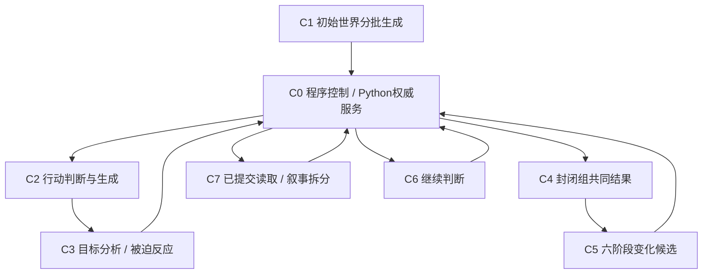

# 交付项 1：组件职责与接口表

日期：2026-10-28。版本：C接口草案0.1。源码核对基线：`886dfe8`，共享方向：`376d120`。

本文细化已认可的[完整原设计](../../browser-world-state-workflow.md)和[C任务边界](README.md)，交付组件职责、输入输出、模型任务、程序校验、失败处理与验证要求。接口是可评审草案，不表示已经实现、接线或冻结新的生产SDK；不改服务协议。模型名称、权重、运行时和训练方案属于交付项2，本表不据任务形状承诺某个参数量已经胜任。

## 1. 组件结构

七项语义组件对应原设计§7.1。另列程序控制与时间/点位提议，避免把现有十个 `ModelTask` 误认成十个模型，或遗漏 `time` / `pointPlan`。

图中箭头表示数据交接；实际执行服从服务phase、冻结顺序、组闭合和叙事门槛。C3扩张可能递归多次；每个结算单元后执行C5并stage，后续人物才能读新工作态；完成点才commit。关联续段优先于C6，不能每结算一组就提前结束round。

| 组件 | 职责 | 是否需要模型 / 任务形状 | 最小输出 | 当前接线入口 |
| --- | --- | --- | --- | --- |
| C0 程序控制 | 时间、顺序、ID、骰点、准入、工作态、合并、提交、认领、恢复 | 确定性程序；时间/点位可接受模型提议，程序校验 | 已确认操作与只读快照 | `schedule` / `ControllerDriver` / `WorldTransport` → Python服务 |
| C1 初始世界 | 分批生成实体清单、位置、描述、任务、个性和理智，修订后封存 | 生成＋可选抽取/判别；不先承诺一次全量生成 | 草稿分批候选，最后组装 `WorldInitialTemplate` | 当前 `initial`，尚缺分批草稿流程 |
| C2 普通行动 | 指定人物此刻是否行动，若行动则描述 | classify/score＋generate，可合并调用 | `act(text)` 或 `skip` | 当前 `action` |
| C3 被迫行动 | 分析冻结行动牵连对象；程序准入后生成反应 | 关系判断/多标签分类/候选打分＋generate | 目标ID集合；被准入人物的反应文本 | 当前 `targets`、`reaction` |
| C4 共同结果 | 读取封闭组全部行动与骰点，统一生成结果 | 条件生成，可先规划后实现 | 全组成员结果描述 | 当前 `results` |
| C5 六步变化 | 从当前阶段状态与结果生成合法候选 | 分类/抽取/引用选择、文本生成、数值预测，按阶段组合 | 六阶段候选＋实际完成检查的覆盖记录 | 当前 `updates`，见§4 |
| C6 继续推进 | 判断是否存在大概率且与主角有关的后续行动 | 候选短生成＋关联/发生可能性判断；可拆或共享 | `continue` 的人物/拟行动/关联依据，或 `handback` | 当前 `continuation` |
| C7 叙事 | 只从已提交事实选择、组织并成句 | 程序提取＋选择/排序/指代＋生成＋核对 | 叙事候选与事实覆盖/问题记录 | 当前 `narration`，见§5 |

这些是软件职责，不是权重数量承诺。分类、排序等可共享编码器；自然语言生成可共享骨干。分类器选取已有引用不等于通用生成器；最终选择以专项质量和环境内总成本为依据。

## 2. 共用的输入、输出和错误边界

### 2.1 输入分为程序绑定和模型内容

| 项目 | 来源与约束 | 是否进入模型内容 |
| --- | --- | --- |
| 工作身份与新鲜度 | 由调度器保留world/advance/input/round/point/group、head版本/摘要、checkpoint revision、epoch及调用任务身份；仅使用本次适用字段 | 只给完成语义任务必要的ID，不传授权token |
| 工作世界 | 最近一次适用基线/阶段的Python `preview_point.data.workingState`；时间已先应用，不能拿前阶段过期状态代替 | 当前人物/全局任务等所需状态与自然语言原文；裁剪不能漏掉规定覆盖 |
| 已确认行动、目标、骰点 | 冻结工作/恢复投影和控制器留存；缺任何成员原文或判定先补读/停止 | 原文、ID、实际roll/eligible/admitted等语义输入 |
| 提交后叙事 | 目标点和其明确前驱的正式 `GetStateData`，见§5 | 事实所需字段、原始Δ、视角；不能换成结果文本 |
| 开局草稿 | 用户设定、规模、程序登记清单及已采纳草稿批次 | 对应批次；不虚构运行中新增实体 |

输入装配与结果采纳由程序完成。模型返回时重新核对调用仍属于当前身份、版本、阶段和epoch；失效或取消的迟到输出隔离，不悄悄套用到新状态。这里是内部调用元数据，不新增wire字段、数据库表、长期行动历史或人物知识状态。

### 2.2 输出分三种，不能相互替代

- **语义候选：** 明确的act/skip、目标集、结果、增量、继续决定或文本；仍需结构和语义核对。
- **合法的无变化/否定：** 经实际检查后返回skip、空目标、当前阶段无变化、无后续行动；必须能区分“检查完成”与“根本没执行”。
- **未完成：** 输入缺失、格式错误、截断、无法判断、取消或超时。保留证据、停止采纳；不能变成skip、空增量、空目标或handback。

上述类别是C内部接口语义，不添加服务错误码。任务ID、模型/配置身份、实际调用、原始输入输出、耗时、结束原因、校验与修复记录进入实验报告，按README的数据隔离和测时规则管理。

现有 `WorldModelPort.generate(task,key,input:Json):Promise<Json>` 可以由后续适配器承接；本表不直接修改它。编码器的标签/分数/跨度可以先走内部结构化返回，再在边界转换成现有调用形状，不要求所有小模型先生成聊天文本或JSON。

### 2.3 失败、重试与恢复

格式拒绝、截断和语义问题分别统计；重试预算在运行配置中显式给出。未确认候选可以在允许范围修复，重生仍绑定同一输入并计费。行动/目标/骰点/结论一旦服务确认，后续恢复读确认结果，不因换模型、刷新、超时而重采样、重掷或翻转决定。HTTP未知结果按既有requestId/载荷规则重放，不等于再做一次模型生成。

叙事失败只影响叙事认领/门槛，不能重跑已完成世界结算。当前页面门与一次重生/模板回退策略保持原状；C的内部核对结果本轮不接页面放行。预算暂停和剧情handback始终分开。

## 3. 七项组件的输入输出与校验

### C0：程序控制与辅助提议

`WorldContext`、`PointWork`、`ControlState`及分配结果是控制依据。冻结顺序、visited/acted、组成员、DFS进度、准入、阶段和门槛由程序与服务确定；模型不能修改。`canCompute=false` 按既有操作边界停止状态相关调度。

`pointPlan` / `time` 是控制辅助提议：输入应包含与时间/分段判断有关的当前世界和冻结槽位，输出为时间跨度/边界及分段覆盖建议。程序绑定点身份、检查非负/瞬时/关联时间约束并由服务确认；时间锁定后不能重提。点位覆盖不代替逐人物act/skip，未列人物不能被程序默认为跳过；已处理人物也不重复询问。它们属于现有任务适配的待完善边界，不增加第八个产品语义组件。

### C1：初始世界分批生成

| 子步骤 | 输入 | 内部候选输出 | 程序检查 / 交接 |
| --- | --- | --- | --- |
| 清单与拓扑 | 世界设定、规模、已登记清单 | 地点树草稿、人物/物品清单及草稿引用 | 程序管理草稿键和初始实体ID，去重/计数/引用校验；正式worldId在创建服务绑定 |
| 位置与描述 | 已登记实体及拓扑、设定、已生成部分 | 每实体位置与外貌原文 | 嵌套/相对位置合法、引用完整、字段覆盖，不改已确认身份 |
| 人物定义 | 人物、世界、描述和已有草稿 | 初始任务树、个性，再按个性预测初始理智 | 同人物任务归属/父子树、无环、数值约束；允许修订草稿 |
| 确认封存 | 完整草稿与用户确认 | 组装已有 `WorldInitialTemplate` | 复用Python创建模板与初始状态校验后提交，之后不改写初始描述 |

不声称在world创建前调用需要world身份的运行时 `allocate_ids`；初始登记和运行中新task/change的服务分配分别处理。模型可用程序给定的草稿槽位，不获得永久身份分配权。设定一致性需要语义评测，不能由引用校验代替。当前 `initial` 的完整JSON输出只是兼容出口，分批修订/覆盖记录及确认流程是未实现接线，集成顺序仍按原计划最后接初始生成。

### C2：普通行动

- **输入：** 指定actorId、时间已推进的最新工作状态、该人物任务和当前有效个性、必要空间/实体状态、与advance/input身份绑定的玩家原文及intentStatus。主角是状态字段，不假定actor就是主角。
- **内部输出：** `skip`，或 `act`＋行动文本；可拆“判断→生成”，两段读取同一输入。可核的短依据用于实验，不进入正式action请求。
- **兼容输出：** 当前codec的 `{kind:'skip'}` 或 `{kind:'act',text}`。解释、置信分数等内部元数据不能直接塞进闭合codec。
- **程序检查：** actor在册且本机会未处理，输入身份/新鲜度一致；act文本非空。成功生成后经discover确认冻结，再分析目标；不以命令解析成功证明行动已经发生。
- **语义验收：** pending输入仍需判断能否执行；consumed/expired不重做原命令；NPC按自身任务/个性行动。固定非主角skip或只识别三类命令不算该组件完成。

### C3：目标分析与被迫反应

| 子接口 | 输入 | 内部输出 / 现有兼容输出 | 程序权威与验证 |
| --- | --- | --- | --- |
| 目标判断 | 当前源ID、已冻结行动原文、最新工作状态、组/资格等相关上下文 | 目标ID集合及短关联依据；当前 `targets` 仅接受 `{targets:[{targetId}]}` | 程序验证人物引用/去重、分配triggerKey、确认完整目标集（含空集），再按锁定规则掷骰及判准入 |
| 反应生成 | 源威胁原文、被准入人物、最新状态及任务/个性、程序确认的骰点与组关系 | 该人物反应行动文本；当前 `reaction` 是非空文本 | 未准入或已行动不生成第二次反应；确认原文并加入分析队列，防止环和重复成员 |

目标分析不能因目标已行动就抹掉威胁/骰点输入，后者仍可影响C4。完整目标集已确认后不能重采样；某人物因另一关系已被接纳时复用其冻结行动。模型不输出triggerKey、ruleVersion、阈值或rollId。恢复缺原文/判定时明确停止，不能凭成员名册编写替代行动。

当前 `targets` 输入只有sourceId/actionText/workingState，`reaction` 只有source威胁/member/rollId/workingState；完整组/资格/判定上下文若为所选拆分所需，须由B从既有服务读取/控制记忆装配，不假装现有rollId就是模型已看到骰点数值。依据和分数为内部分析数据，持久化仍只使用现有正式形状。

### C4：共同结果

- **输入：** 已封闭groupId、全组成员的冻结行动（按程序提供的稳定顺序）、每条威胁的实际骰点与eligible/admitted（含未准入与目标已行动的关系）、结算前最新工作状态。缺一名成员原文不得开始。
- **输出：** 按组成员ID覆盖的共同结果描述，可先作内部结果规划再成文；现有 `results` 兼容出口是 `Record<Id,string>`。不是给每人互不相关地自由写一段后直接拼接。
- **程序检查：** 组已经close、输入成员与保存来源匹配、成员覆盖完整且无额外身份，结果非空；不能把只能看单源的模型调用声称为全组共同结算。
- **语义验收：** 结果符合全部冻结行动和骰点，冲突统一处理；涉及未登记实体时不得暗中创造实体。程序的结构检查不证明这一语义条件。
- **交接：** results是供C5解释/核对的**候选描述**，不是已提交世界事实，不授予直接写状态的权利；通用链不要求持有规则示例专用的 `RuleReceipt`。C5接受的结果修订须使未确认下游候选失效；已确认工作按服务恢复/冲突规则处理。

### C5：六阶段变化

所有阶段以当前阶段的Python工作投影为输入，并保留本次完整共同结果（纯时间扫描无results）。按原设计，满足依赖与覆盖条件时可合并调用；存在前一阶段状态依赖时必须拆分，不预设统一一次或每阶段恰好一次。下一阶段不能让模型自行在原状态上“想象已应用”，须经过服务preview取得对应阶段状态。

| 阶段 | 必需输入与检查范围 | 任务形状 / 内部输出 | 正式候选字段与程序校验 |
| --- | --- | --- | --- |
| U1 位置 | 结果＋当前人物/物品位置与位置图 | 位置引用/关系选择；必要时语义抽取；逐受检实体变化/不变化 | `positions` / `positionSet`；在册、联合图无环、slot/relative引用合法；地点拓扑不作为运行中移动对象 |
| U2 外貌 | U1预览后状态＋结果，人物/物品/地点的初始与有效外貌 | 变化判别＋新描述生成＋替代引用选择 | `appearances` / `appearanceChanges`；初始原文不可改，change身份程序分配，supersedes范围和来源合法；解除也不能丢 |
| U3 任务达成 | 推进后时间、U2状态、**全人物全部当前任务**及任务原文 | 每任务达成/未达成判断，必要来源依据 | `tasksAchieved`，并记录实际完成的task coverage；身份/归属合法，不能只看组成员/附近人物或只检查返回变化的任务 |
| U4 新小任务 | U3状态、已有任务树与本次判断 | 生成是否有助于已有父任务的小目标及父引用 | `subtasksAdded`；同人物已有父任务，禁止新根/环/覆盖旧ID，草稿键由程序替换为服务分配身份 |
| U5 个性 | 有新达成任务才触发，U4状态及**全部人物**的任务/个性和达成信息 | 逐人物变化/不变化判断＋变化文本/替代引用 | `personalities` / `personalityChanges`，有任务触发时personality coverage为全名册；允许所有人均不变，不强制任务/个性成套 |
| U6 理智 | 仅本次有个性变化人物的当前有效个性（含解除）和已更新状态 | 数值预测或受限分类，输出最终整数值 | `sanities` / `sanitySet`；与个性变化人物集合配对、0–100、无事件直扣/每轮恢复/固定增减；不静默截断或夹到边界 |

程序据各阶段**实际完成的检查**装配现有 `SettlementGroup`。当前阶段模型出口是 `UpdatesCall={stage,changes}`（拆分单对象、批量数组），不能把新增coverage/rationale元数据直接塞进现有codec或wire；适配器在内部保留完成记录，再生成既有字段。

coverage完成记录至少能核对本阶段预期人物/任务与实际输入批次、已完成返回；无变化的人物/任务也要纳入。批次结果不完整或无法判断时保留未完成；不能因为 `assembleCandidates` 能填全名册，就宣称模型真的扫描完整。该记录是本次调用工作数据与实验审阅依据，不建立独立长期事实库。

纯时间单元的U1/U2为无操作，U3/U4仍按全局任务执行，U5/U6按触发条件执行；最后才能确定实体Δ为空。达到某时刻可以达成任务并合法联动，不要求虚构一段动作解释。

单元候选经stage确认，点结束由Python合并。旧任务达成与本点新增任务后来达成按既有规范分别编码；后者最终在 `subtasksAdded` 保留最终status，不能同时在 `tasksAchieved` 伪造第二份记录。程序分配/重写定义和引用，模型不生成永久ID。模型语义不一致时保留失败，不由“最后写入覆盖”解决共同冲突。

### C6：继续推进

- **输入：** 主角ID与状态、当前完整世界、当前round全部已提交点的时间与原始Δ（按提交顺序）。程序绑定另保留服务确认的advance/input与消费状态，不要求为此新增wire或强行增加模型输入字段。缺当前世界或本轮历史必须停止补读，不能把缺失当“无变化”。
- **内部输出：** `handback`，或 `continue`＋非空候选人物列表，每项含拟行动及“为何大概率发生/如何关联主角”的短依据。可以拆候选生成和两个条件判别；不能用一个泛泛相关度代替两个条件。
- **程序/服务：** 核对人物在册及两个判别均已完成；程序分配/绑定nextRoundId，映射为已有 `ContinueConclusion` / `ModelHandback`。拟行动与依据只用于本次判断，不进入长期行动历史；模型不得直接创造持久化轮次身份。
- **验收：** continue经服务原子结束旧round、创建下一round并重排，实际行动仍回到C2按新状态判断；不能把候选当已发生行为，也不能重新消费原命令。关联点未完成不得抢先判断。
- **当前缺口：** 现有模型出口包含candidateCharacterIds/nextRoundId，但没有上述拟行动/双条件依据的内部结构；B需要装配/适配该判断证据，并让程序提供轮次身份，不能把提示词写了要求当成组件已完成。内部依据不扩展现有RoundConclusion字段。

### C7：已提交叙事

见下一节。接口刻意不复用 `CommittedNarration` 作为通用定义，也不把C4结果文本作为叙事事实。C7不能回写世界状态、增加实体或从叙事抽取新Δ。

## 4. 现有任务到组件的适配清单

| 当前ModelTask / 类型 | 对应组件 | 已有边界 | 本接口表揭示的待办 |
| --- | --- | --- | --- |
| `initial` / `WorldInitialTemplate` | C1 | 模板校验、整份输出codec | 分批草稿、身份管理、覆盖、修订与确认封存 |
| `action` | C2 | actor/advance/workingState，act或skip | 专用判断/生成拆分，真实语义质量；不能只接规则端口 |
| `targets` / `reaction` | C3 | 目标ID集合、反应文本；程序骰点/确认 | 需要时装配组/资格/实际判定上下文；内部依据与闭合codec分开 |
| `results` | C4 | groupId、成员原文/rollRefs、workingState | 全组结果一致性与成员覆盖检查，候选文本≠已提交事实 |
| `updates` / `SettlementGroup` | C5 | 阶段changes、preview、task/personality coverage字段 | 显式实际检查记录、合法无变化、跨人物影响、新小任务与广泛状态支持；不由名册填充冒充扫描 |
| `continuation` / `RoundConclusion` | C6 | 当前世界/本轮变化、continue或handback | 拟行动＋发生可能性/主角关联双条件、程序持有nextRoundId |
| `narration` / `GetStateData` | C7 | 目标点原始Δ与前后状态组装、claim/gate | 通用投影、选择/组织/成句接口与核对，见§5 |
| `pointPlan` / `time` | C0辅助 | 点位/时间提议的现有出口 | 逐人行动机会不被分段预选替代；提议输入上下文和程序身份绑定 |
| `InferenceEngine.complete` | 所有模型任务 | 当前文本生成端口、取消/完成证据 | 编码器/任务头与T5运行路径另选；不把label任务强行当自回归聊天；留待交付项2 |

本表列的是需要B承接的适配与语义验证，不声称C修改了这些源码，也不凭静态阅读判定每一项都是线上缺陷。

## 5. 叙事拆分的具体输入输出

### 5.1 外部只读输入

复用R1后正式冻结的 `GetStateData`，保留目标点 `pointId/version/state/stateDigest/previousPointId/timeAdvance/entityDeltas`。若有前驱，按其明确ID读取before记录，并核对同世界、前驱身份和连续版本；根点before为null、version为0、时间null、Δ为空。报告固定采集/生成目标点，不能用之后的新head替换它。

程序验证读取完整与血缘，服务负责回放/摘要权威；C不自行apply或实现规范摘要。服务缺字段/前驱时明确未完成，不能从前后状态差分制造原始Δ。视角约束与主角身份从状态/调用要求取得，不引入独立人物知识库。

### 5.2 五个子步骤

以下名称仅为内部候选接口。局部factId、planId、来源路径和覆盖标签不进入世界协议、Δ、长期行动历史或摘要。

| 子步骤 | 输入 | 具体输出 | 程序约束 / 小模型职责 |
| --- | --- | --- | --- |
| N1 事实提取 | after读取、before读取/null、原始Δ、视角参数 | 事实条目：局部factId、entityId、类别、before/after值、来源读取与字段路径、变化或现状来源、可引用原文；时间单列 | 程序枚举结构化变化/现状引用，保留全部支持字段及未知项诊断，不让生成模型重新猜世界差异；复杂自然语言含义仍由后续理解 |
| N2 内容选择 | N1条目、主角视角、必要原文；可选已述缓存 | selectedFactIds、每项表达意图与短依据、被省略项及原因；任务定义中的mustExpress与mayMention分别保留 | 候选形状是分类/打分/引用选择；不得新增事实；必述漏选记失败，可选漏说不当事实遗漏；视角/秘密处理是模型语义评测，不伪造已确定可见性字段 |
| N3 组织表达 | 已选事实、原文、必要before称呼上下文；可选已述缓存 | 有序句组，每组factIds、主体entityIds、称呼/指代建议、原文引用；时间表达位置 | 模型排序/分组/指代；程序检查事实引用、所选覆盖/重复及引用有效。角色重名仍用entityId区分，不改世界名册来适配模型 |
| N4 成句 | 有序计划＋其中引用的事实/原文＋视角，不重复灌全世界 | 正文候选；模型可提供句段到plan项的对齐提示，但提示本身不是忠实证明 | 短文本生成，保持事实归属/方向/数值；不增写未保存的行为或具体对话。单短语臂只是成本/输入复杂度对照，最终允许自然表达与选择 |
| N5 核对 | 原始权威读取、N1来源、已选/必述内容、计划与正文 | 结构结果、覆盖、角色/方向/数值/新主张问题及来源；语义不确定项另列，最终产出实验判定 | 能确定的引用/字段关系由程序核对；语义模型候选与人工复核分别记录。模型提供的factIds不能自证文本正确；本轮不替换页面放行门 |

缓存缺失时可在相同已提交读取上重生；不得将缺缓存当作生成失败或保存一套新的事实。省略/重复已知状态的自然度评价与虚构新变化分开；继承容器的隐含移动不能伪造成该子实体的直接位置Δ。原始自然语言字段及supersedes含义不能因难表达就丢掉。

**现有投影待办：** `projectCommittedNarration` 对物品/地点状态变化、外貌、slot/relative位置、独立任务达成、部分个性变更/解除及重名人物存在受限处理。N1的通用输入不预先经过该函数；接口表必须保留这些能力，后续补对应离线开发/验证场景。本轮没有实现N1，也没有把 `narration-split` 的程序基线视为已解决所有这些问题。

**失败交接：** N1缺读取停止；N2/N3引用不合法或漏必述则修复该未完成步骤；N4/N5失败可在预算内只重生文本/相关表达计划，不能重跑世界动作或改Δ。当前页面门能接受的模板可用于对照和显式回退；超出其支持范围时记“不支持/未完成”，不将错误或空串伪装成通用兜底。

## 6. 验证清单与数据边界

本轮只交接口与源码映射。下列是后续新开发样本/组件检查要求，不是已经通过的测试；本轮没有生成语料或重跑B保护集。

| 检查族 | 必须区分的情况 | 对应组件 / 原要求 |
| --- | --- | --- |
| V01 输入身份 | pending与consumed；actor是/不是主角；阶段/epoch变更后的迟到输出；取消/截断≠skip | C0/C2，R06/R12/R14 |
| V02 反应关系 | 无目标/未准入/已行动/准入后继续牵连；环与同目标多源；保存后不重采样 | C3/C4，R07/R08/R13 |
| V03 共同一致性 | 全部成员原文/骰点完整与缺失；结果一致与冲突；描述候选不越权成事实 | C4/C5，R01/R05/R07 |
| V04 六步依赖 | 位置影响外貌必须分开；任务检查完成且无变化 vs 根本没检查；新任务引用；跨人物个性与合法不变化；有/无个性时理智规则 | C5，R02/R03/R09 |
| V05 时间/覆盖 | 无人物行动但任务达成；分批全名册/全任务覆盖与漏批；stage与commit分开 | C0/C5，R04/R05/R09 |
| V06 自动链 | continue/handback真实双条件；缺轮内历史；预算暂停；续轮重排且输入不重做 | C6，R06/R10/R16 |
| V07 叙事读取/投影 | 根点/历史点/新head出现；原始Δ与差分不同；物品/地点/外貌/复杂位置/解除/重名 | C7，R02/R03/R04/R11 |
| V08 叙事表达 | mustExpress和mayMention；指代/方向/人物互换；原文引用；时间/空点；合法省略与新增事件分开 | N2–N5，R11/R12/R13 |
| V09 初始生成 | 分批缺字段、引用冲突、任务树环、修订身份稳定、确认封存后不能改初始值 | C1，R01/R02/R03/R15 |

实际实验数据按[README隔离要求](README.md)另行建立来源清单和去重记录；不得使用hv/nv/ns/B历次校准实例或改名派生例。当前只是定义检查族，没有创建一套正式新留出集。指标门槛、样本量、具体模型和运行时在交付项2/3中明确，不从旧归档数字直接推导C通过阈值。

## 7. 实现与交付次序

1. 本文完成七组件、六更新阶段、五叙事子步骤、辅助时间提议以及现有task映射；仅是交付项1。
2. 下一项为具体候选/任务头/训练/运行时表；尤其先区分编码器与T5文本生成运行路径，不要求共享现有wllama实现。
3. 在隔离的开发记录上先离线验证N2/N3/N4及核对边界，再做浏览器适配；离线/浏览器报告分开。组件可逐项替换与对照，但程序参照不计作模型通过。
4. A/B按职责接服务/运行层/页面；C不改共享协议或当前真实整链脚本。本文件不宣布所有接口已部署、模型已适配、性能达标或既有H2/页面验收覆盖新组件。

## 8. 组件—模型—证据—待办总表（复核轮 18）

阶段口径沿用[README完成标准](README.md)：**仅方案 → 已训练 → 离线验证 → 浏览器验证 → 已接线**。本表是当前唯一进度口径；旧文里"待交付/未运行"的措辞以本表为准。

| 组件 | 程序负责 | 模型负责 | 首选候选 | 备选 | 阶段 | 证据 | 主要缺口 |
| --- | --- | --- | --- | --- | --- | --- | --- |
| C0 程序控制 | 时间、顺序、ID、骰点、准入、合并、提交、恢复 | 无（时间/点位可提议，程序裁决） | 无模型 | — | 已接线（A，H2 冻结） | `artifacts/h2-freeze-d1d2de0.json` | 不含 C 组件；时间提议未启用 |
| C1 初始世界 | 清单、校验、封存 | 分批生成实体/位置/任务/人格 | 生成骨干 Qwen3-0.6B（候选） | Randeng-T5-77M | 仅方案 | — | 分批草稿流程、引用冲突校验、封存后不可变，全部未实现 |
| C2 普通行动 | 准入、身份、冻结 | act/skip 判断＋行动文本 | 生成骨干单调用（Qwen3-0.6B） | MiniRBT 二分类头＋生成 | 仅方案 | B3 短测有 action 形状，非 C 验收 | 需按 V01 建样本；旧 5 类 action_type 不可复用 |
| C3 目标分析/被迫反应 | 牵连准入、冻结原文 | 目标多标签/候选打分＋反应文本 | 编码器候选打分头（MiniRBT-H256）＋生成骨干 | 生成骨干同调用 | 仅方案 | — | 目标判定与"被迫"边界未测 |
| C4 共同结果 | 组闭包、骰点输入 | 全组统一结果文本 | 生成骨干（Qwen3-0.6B） | Mengzi-T5-base（容量对照） | 仅方案 | — | 需封闭组样本；质量未测 |
| C5 六步变化 U1–U6 | 合法性、边界、合并、clamp | 位置/外貌引用选择、任务达成判断、新任务草稿、人格、理智 | U3/U5 编码器 cross-encoder（MiniRBT）＋生成骨干 | U6 分桶/回归对照臂 | 仅方案 | — | 六阶段样本未建；U3 全人物×全任务批量判定是编码器最有量场景 |
| C6 继续判断 | 双条件核对、handback | 候选短生成＋发生可能性/主角关联判断 | 生成骨干 | 生成＋编码器双头打分 | 仅方案 | — | 判据要区分"关联续段"与"新行动" |
| C7 N1 事实提取 | **全部**（不让模型猜差异） | 可选归类加速 | 程序 | 编码器变化类型归类头（仅加速） | 已实现（程序权威） | `n4_render`/`validate_plan_authority.py` 的 plan→Δ 对账 | 物品/地点/复杂位置的支持面仍待扩展 |
| C7 N2 内容选择 | 引用校验、覆盖检查、视角硬约束 | must/may/forbidden 的取舍判断 | 编码器打分头（事实×视角）**待训** | 0.6B instruct 生成编号（首轮证据不足） | **首轮离线对照完成（无模型通过）** | `artifacts/world-components/n2-selection-r1.json` | 需建训练集并测打分头；判据阈值未冻结 |
| C7 N3 组织表达 | 顺序/指代校验、事实覆盖 | 排序、分组、指代 | 程序基线先行，模型待定 | 0.6B instruct | 仅方案（承接安排已定） | — | 程序基线 B1/B2 未实现，指标未跑 |
| C7 N4 成句 | 渲染器、判据、冻结校验 | 事实计划→中文正文 | **Randeng-T5-77M 全参微调（r3-direction）** | Qwen3-0.6B（现役基线） | **离线验证通过（六类短计划）** | `n4-holdout-eval-r3-direction.json`（44/44） | 浏览器端到端、JS sentencepiece、共存开销未验证；风格偏模板 |
| C7 N5 核对 | **程序为主**（`corpus_check` 识别器） | 语义复核候选 | 程序判据 | 编码器一致性头（不自动放行） | 离线可用（Python） | `corpus_check.py` v5、13 例篡改自检 | 运行时 JS 版判据未交付，B 侧门控仍用现有实现 |

### 8.1 当前验证范围（避免过度外推）

- **已验证的只有一个组件**：N4 成句，且仅限六类短计划、4–5 条事实、1–2 句输出、离线 Python。
- **N2 只完成首轮对照**：程序规则臂 16/16，0.6B 零样本 4/16（11 次选到视角不可知事实），T5 零样本 0/16；没有任何模型通过正式门。
- **N3 未开始**；C1–C6 全部停留在接口方案，没有训练或质量证据。
- **浏览器侧**：编码器路线（MiniRBT＋ORT-web int8）有旧批实测（F4）；T5 生成路线与全部新组件在浏览器内**均未验证**。

### 8.2 各组件还缺什么（按优先级）

1. **N2**：训练集（事实×视角→保留/丢弃）、编码器打分头、预登记判据与冻结开发/留出划分。
2. **N3**：程序基线 B1/B2、顺序与指代指标、与 N2 的选择口径对齐。
3. **C2/C3/C4**：按 V01–V03 建隔离样本；先做"生成骨干单调用"对照，再决定是否拆小模型。
4. **C5**：六阶段样本与 U3/U5 批量判定；理智方向已由程序计算，模型只需表达。
5. **C1**：分批草稿与引用校验，排最后（原设计集成顺序）。
6. **N4 浏览器化**：sentencepiece JS＋encoder-decoder 循环，属独立工作项。

## 源码与规格依据

- [原设计§3、§6、§7、§8及阶段验收](../../browser-world-state-workflow.md)，[R01–R16能力清单](../full-design-implementation-direction.md)。
- [当前调度器与十类ModelTask](../../../frontend/src/lib/world-engine/schedule.ts)，[控制器与身份/响应采纳](../../../frontend/src/lib/world-engine/controller.ts)。
- [现有模型输出codec](../../../frontend/src/lib/world-engine/runtime/structured-output.ts)，[模型端口](../../../frontend/src/lib/world-engine/runtime/model-port.ts)，[推理引擎接口](../../../frontend/src/lib/world-engine/runtime/engine.ts)。
- [正式GetStateData与请求/响应](../../../backend/app/schemas/world/v2/requests.py)，[SettlementGroup与冻结工作](../../../backend/app/schemas/world/v2/work.py)，[世界状态与结论类型](../../../backend/app/schemas/world/contracts.py)，[控制上下文](../../../backend/app/schemas/world/v2/contexts.py)。
- [受限叙事投影及旧门](../../../frontend/src/lib/world-engine/runtime/committed-narration.ts)，[现有程序拆分基线](../../../frontend/src/lib/world-engine/runtime/narration-split.ts)。

证据仅为本轮指定提交的源码/规格核对；没有借用B样本作C开发，也未变更共享文件。
